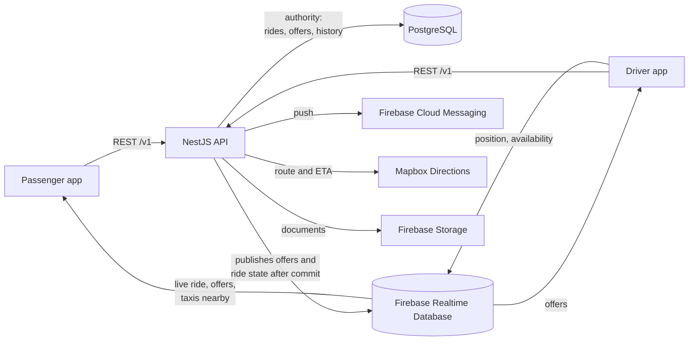

# Taxi Vroom API

Backend of **Taxi Vroom**, a ride-hailing app for French licensed taxis: legal price estimate, live matching with the nearest free driver, and a full ride from order to meter price.

Mobile app (Flutter, passenger and driver in one app): [taxi-vroom-mobile](https://github.com/TaxiVroom/taxi-vroom-mobile)

## Demo

[](VIDEO_URL)

## Architecture



Inside the API: NestJS, Domain-Driven Design and CQRS.

```
write: HTTP controller → CommandBus → service → domain entity → repository → domain events
read:  HTTP controller → QueryBus → query handler → Prisma (read model)
```

Modules (`src/modules`): `ride`, `registration`, `driver`, `passenger`, `user`, `notification`, `auth`, `admin`, `wallet`, `enterprise-contact`. They talk through domain events: the emitter never knows who listens. The import rules between layers are checked by `npm run deps:validate` ([dependency-cruiser](.dependency-cruiser.js)).

## Key decisions

| Decision | Why |
|---|---|
| [Mapbox](src/modules/ride/infrastructure/mapbox-route-planner.adapter.ts) instead of Google Maps | Cost |
| [Firebase Cloud Messaging](src/modules/notification) for push | No messaging infrastructure to run. See the [spec](docs/specs/notifications-push.md). |
| [Firebase Realtime Database](src/modules/ride/infrastructure/firebase-ride-realtime.adapter.ts) for live positions and offers, not Firestore, Fleet Engine or a self-hosted WebSocket | Firestore bills every write, Fleet Engine has no Flutter SDK, a WebSocket server is more to maintain. Postgres stays the authority, Firebase only holds a copy. |
| [Partial unique indexes](prisma/migrations/20261006171646_add_rides/migration.sql) settle dispatch races | One pending offer per ride and per driver, enforced by the database. A conflict tries the next driver. |
| [Graphile Worker](docs/specs/documents-du-chauffeur.md) for scheduled jobs, not BullMQ or pg-boss | Jobs live in Postgres, so they are scheduled in the same transaction as the write. No Redis. |
| [CQRS](src/modules/ride/queries/find-my-rides/find-my-rides.query-handler.ts): reads never go through the domain | A query returns a lean read model with its own Prisma query. |
| [Every ride rule lives in `RideEntity`](src/modules/ride/domain/ride.entity.ts) | Services only orchestrate. Statuses are a discriminated union, so an impossible combination cannot be written. |
| [Money is an integer in cents](src/modules/ride/domain/taxi-fare.ts) everywhere | No rounding error. Named `...Cents` in the code, the database and the API. |

Every feature starts with a spec in [`docs/specs/`](docs/specs/): what the user sees step by step, then a sequence diagram with the routes, tables and events.

## What it does

- Legal price estimate: the official taxi meter formula (day, night, Sundays, public holidays), shown as a range before ordering.
- Matching: one offer at a time to the closest free driver within 5 km, 15 s to answer.
- Full ride: order, accept, arrive, boarding code, start, complete, plus cancel, withdrawal and no-show.
- Advance bookings, with a reminder to the committed driver and reassignment if they are not ready.
- Driver onboarding: documents, admin validation, then expiry dates, renewals and blocking.
- Ratings, ride history, driver earnings.

## Run it locally

You need Node.js 20, Docker, a Firebase project and a Mapbox token.

```bash
npm install
cp .env.example .env     # then fill it, see src/configs/env.validation.ts
npm run docker:env       # PostgreSQL on 5432, pgAdmin on 5050
npm run migration:deploy
npm run prisma:generate
npm run db:seed          # document types and a demo passenger
npm run start:dev        # http://localhost:3000, Swagger at /docs
```

The app validates its environment at boot and refuses to start if a variable is missing. The Bas-Rhin tariff row is not in the seed, it is inserted by hand.

## What I'd improve

- Automated tests: the rules sit in domain entities, so they can be tested without a database. There are none yet.
- An admin role, with the features that depend on it: rejecting a document and suspending a driver.
- Push notifications on iOS, which is prepared but untested for lack of an Apple device.
- A heartbeat for drivers whose phone loses the network for good.

## Contact

