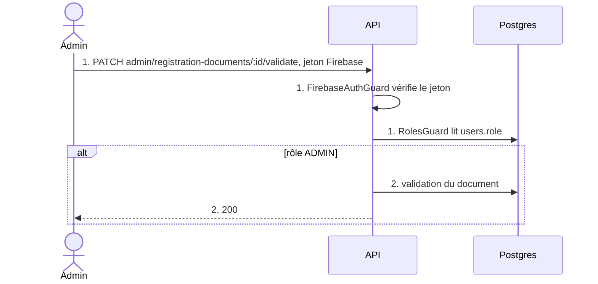
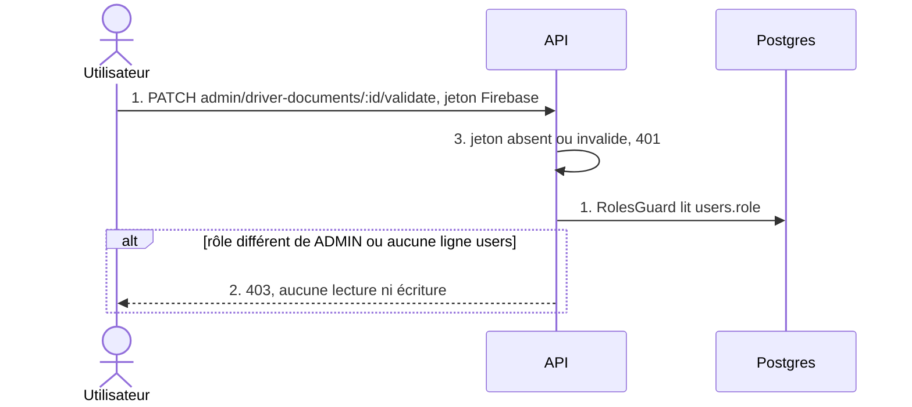

# Accès réservé à l'admin

> Statut : étapes 1 à 3 codées le 2026-11-16 (go du user pour toutes les étapes, exception à `stepPause`) : `tsc` propre, lint à ses 9 erreurs habituelles, `deps:validate` à ses 5 anciennes violations, pas commité. Reste l'étape 4, celle du user : créer le compte admin et tester.

Concerne `taxi-vroom-api` seulement. Le mobile n'appelle aucune de ces routes (`users`, `admin`), vérifié le 2026-11-16.

Les schémas sont des diagrammes de séquence Mermaid. GitHub les dessine dans les fichiers Markdown ([doc GitHub](https://docs.github.com/en/get-started/writing-on-github/working-with-advanced-formatting/creating-diagrams)). Syntaxe : [doc Mermaid, sequenceDiagram](https://mermaid.js.org/syntax/sequenceDiagram.html). Un point-virgule dans un message coupe la ligne : les schémas n'en ont pas.

## Spec

### Besoin

Demandé par le user le 2026-11-16, avant de montrer le dépôt en public : des routes laissent n'importe quel porteur d'un jeton Firebase valide faire ce que seul un admin devrait faire. Elles sont notées depuis le 2026-11-02 (`hyp` usersRoutesUnprotected), le user avait repoussé le correctif jusqu'avant un dépôt public.

Code lu le 2026-11-16 : les gardes globaux (`FirebaseAuthGuard` puis `RolesGuard`) ne vérifient le rôle que sur les routes qui portent `@Roles`. Les routes ci-dessous n'en ont pas :

| Route | Ce qu'elle permet aujourd'hui, à tout jeton valide |
|---|---|
| `GET /v1/users` | lister tous les utilisateurs (e-mail, téléphone, prénom, nom) |
| `DELETE /v1/users/:id` | supprimer n'importe quel utilisateur |
| `PATCH /v1/admin/registration-documents/:documentId/validate` | valider un document d'inscription, donc faire valider son propre dossier et devenir chauffeur sans contrôle |
| `PATCH /v1/admin/driver-documents/:submissionId/validate` | valider un document renouvelé d'un chauffeur |
| GraphQL `findUsers` et `createUser` (`/graphql`) | même chose que `GET /users`, résolveurs du template sans `@Roles` |

Vérifié aussi le 2026-11-16 : toutes les autres routes ont un `@Roles`, sauf celles de l'inscription (`registration-flows/*`, `registration-document-types`, `POST passengers`), qui tournent en `GuestUser` voulu, car la ligne `users` n'existe pas avant la fin de l'inscription. Chaque route de course vérifie que la course appartient à l'appelant : dans l'entité (`RideEntity`, `passengerId` ou `driverId`) pour les écritures, dans le `where` de la requête pour `boarding-code` et `checkout`.

### Comment ça marche

#### 1. L'admin valide un document

1. L'admin se connecte avec son compte Firebase et appelle la route de validation (Swagger ou outil HTTP, il n'y a pas d'écran admin).
2. Le document passe à validé. Rien ne change par rapport à aujourd'hui.

#### 2. Quelqu'un qui n'est pas admin essaie

1. Un passager, un chauffeur ou un compte sans inscription appelle une route admin, ou liste ou supprime des utilisateurs.
2. Il reçoit un refus. Rien n'est lu ni modifié.
3. Sans jeton, ou avec un jeton invalide, il reçoit le refus d'authentification, comme partout.

#### 3. Création du compte admin (à la main, une fois)

1. Le user crée un compte Firebase pour l'admin et note son uid.
2. Il insère à la main en SQL une ligne `users` (`id` = cet uid, `role` = `ADMIN`, e-mail, téléphone, prénom, nom) et une ligne `admins` (`userId` = cet uid), comme la ligne de tarif.
3. Pour valider un chauffeur de test, il utilise le jeton de ce compte, plus « n'importe quel jeton » (`arch` adminValidation et `registration` « to validate a test driver » à corriger).

### Décisions prises

| Décision | Raison | Validation |
|---|---|---|
| `@Roles(UserRoles.admin)` sur les deux routes `PATCH admin/*` | l'enum `ADMIN`, la table `admins` et `RolesGuard` existent déjà : rien à ajouter au garde | validé par le user, 2026-11-16 |
| `@Roles(UserRoles.admin)` sur `GET /users` et `DELETE /users/:id`, les routes restent | changement minimal (`onlyWhatAsked`) | validé par le user, 2026-11-16 |
| Compte admin créé à la main en SQL, sans route ni seed | un seul admin, le user | validé par le user, 2026-11-16 |
| Retirer les deux résolveurs GraphQL du template (`createUser`, `findUsers`) | restes du template, jamais utilisés par l'app, et le garde global est écrit pour HTTP (`switchToHttp`), son effet sur GraphQL n'est pas établi. La doc officielle NestJS de la version installée est lue avant de coder (`officialDocs`), et si elle montre qu'un garde les protège déjà, la décision est revue | choix technique, à valider avec cette spec |
| `RolesGuard` inchangé | il refuse déjà quand la ligne `users` manque ou que le rôle ne correspond pas | choix technique |

### Règles

- Une route réservée à l'admin porte `@Roles(UserRoles.admin)` : le garde lit `users.role` dans Postgres à chaque appel.
- Les routes de l'inscription restent en `GuestUser`, sans `@Roles`.
- Aucun nouveau garde, aucune nouvelle table.

### API

Aucune route ajoutée. Quatre routes existantes passent derrière `@Roles(UserRoles.admin)` : leur réponse change de « 200 pour tout jeton valide » à « 403 sans le rôle ADMIN ». Deux résolveurs GraphQL sont retirés. Les contrôleurs, DTO et réponses ne changent pas, et `docs` Swagger n'est pas touché.

### Nouveaux éléments

Aucun fichier de code ajouté. Fichiers modifiés (à confirmer à la lecture, au moment du code) : les deux contrôleurs `admin/*`, `delete-user.http-controller.ts`, `find-users.http.controller.ts`, `user.module.ts` (retrait des deux résolveurs), les deux fichiers de résolveur supprimés.

### Tables touchées

Aucune table modifiée. Lecture de `users.role` par `RolesGuard`. Insertion à la main d'une ligne `users` et d'une ligne `admins` pour le compte admin.

### Hors périmètre

- Rejet d'un document par l'admin et suspension d'un chauffeur (`hyp` documentReviewUnfinished, suspensionNotEnforced) : features séparées.
- Custom claims Firebase à la place de la lecture Postgres (TODO de `RolesGuard`) : performance, plus tard.
- Écran admin dans l'app.
- Correction du `delete-user.service.ts` sans transaction (bug connu) : à traiter avec la suppression d'utilisateur.

## À valider

- [x] Retirer les deux résolveurs GraphQL du template (voir Décisions), validé par le user, 2026-11-16, avec le retrait de tout GraphQL, paquets laissés dans `package.json`. Cas non prévu, trouvé en lisant le code le 2026-11-16 : sans aucun résolveur `Query`, le schéma GraphQL est invalide (`Query root type must be provided`, `graphql` 16, vu dans `node_modules/graphql/type/validate.js`) et `GraphQLModule.forRoot` fait échouer le démarrage de l'API. Il faut donc retirer aussi `GraphQLModule.forRoot` de `app.module.ts`, les DTO GraphQL du template (`libs/api/graphql/paginated.graphql-response.base.ts`, `user/dtos/graphql/*`, `create-user/graphql-example/*`) et, si le user le veut, les paquets `@nestjs/graphql`, `@nestjs/apollo`, `graphql`. La doc officielle NestJS ([GraphQL, other features](https://docs.nestjs.com/graphql/other-features)) dit qu'un garde doit convertir le contexte en `GqlExecutionContext` pour GraphQL : nos gardes lisent `switchToHttp()`, donc ne sont pas faits pour GraphQL. Alternative : garder GraphQL et lui écrire un garde, plus lourd pour du code jamais utilisé.
- [ ] `POST /v1/users`, `user.create` (contrôleur de messages) et la commande CLI n'ont aucun handler (`CreateUserService` est commenté, `hyp` createUserDead) : les retirer, ou les laisser tels quels, hors de cette feature ? Proposition : les laisser, `POST /users` échoue déjà sans effet. À trancher par le user.

## Plan

- [x] 1. `@Roles(UserRoles.admin)` sur les deux routes `PATCH admin/*` (TODO retirés). `npx tsc --noEmit`, `npm run lint`, `npm run deps:validate` : rien de nouveau.
- [x] 2. `@Roles(UserRoles.admin)` sur `GET /users` et `DELETE /users/:id`. Mêmes vérifications.
- [x] 3. Doc officielle NestJS lue le 2026-11-16. Résolveurs, `GraphQLModule.forRoot` et DTO GraphQL du template retirés. Mêmes vérifications : rien de nouveau.
- [ ] 4. Le user crée le compte admin (Firebase puis SQL, voir situation 3) et teste sur Android et par Swagger : validation avec le jeton admin, 403 avec un jeton de passager.
- [ ] Fin de feature : mettre à jour `hyp` (usersRoutesUnprotected passe à `fixed`), `arch` (adminValidation, routesOther, AdminModule), `ltm` registration et platform (`@Roles` n'est plus « only on ride routes », étape « to validate a test driver »), `done`, cette spec (statut), `docs/a-faire.md` si besoin. Mettre à jour le point « admin role » de « What I'd improve » dans le README de l'API.
