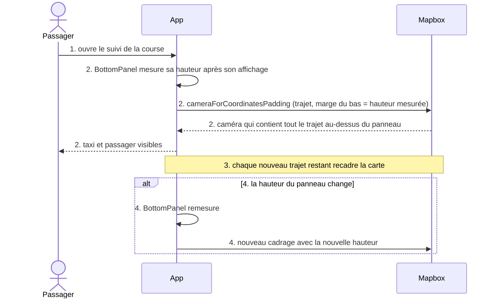
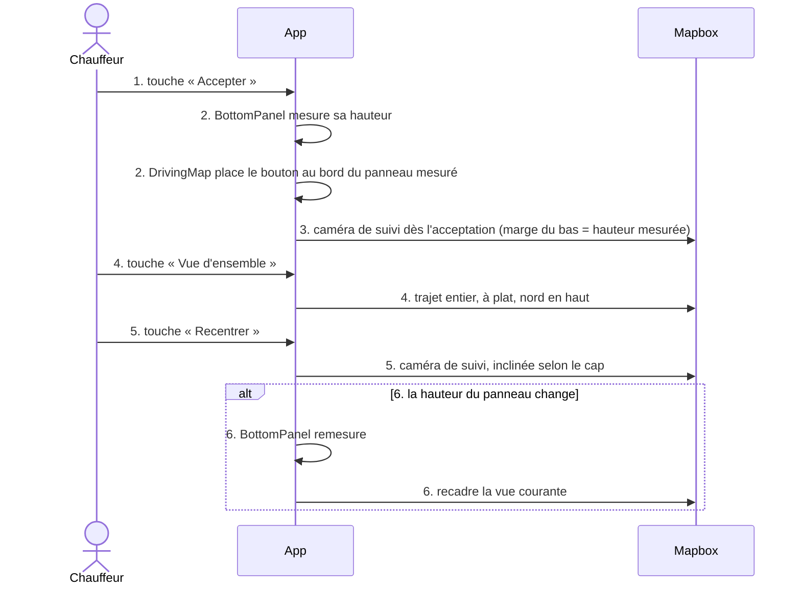

# Cadrage de la carte pendant l'approche du taxi

> Statut : codé le 2026-11-15 (les trois étapes d'un coup, à la demande du user), pas commité. Mobile : `flutter analyze` sans remarque sur les fichiers touchés, 197 tests verts. Attend le test du user sur Android (deux tailles d'émulateur, texte agrandi, trajet vertical et horizontal). iOS non testé. Étape 4 (vue d'ensemble : marges sous la bannière et au-dessus du panneau, chauffeur et passager) codée le 2026-11-15 à la demande du user, validée par lui sur Android le même jour, pas commitée.

Concerne `taxi-vroom-mobile` seulement : l'API n'a rien à changer. Cette spec vit dans l'API.

Les schémas sont des diagrammes de séquence Mermaid. GitHub les dessine dans les fichiers Markdown ([doc GitHub](https://docs.github.com/en/get-started/writing-on-github/working-with-advanced-formatting/creating-diagrams)). Syntaxe : [doc Mermaid, sequenceDiagram](https://mermaid.js.org/syntax/sequenceDiagram.html). Un point-virgule dans un message coupe la ligne : les schémas n'en ont pas.

## Spec

### Besoin

Demandé par le user le 2026-11-15, après un test avec deux positions différentes pour le chauffeur et le passager (jusque-là, le même trajet était toujours refait : chauffeur et passager au même endroit, donc le trajet du chauffeur vers le passager avait une longueur nulle et rien ne se voyait).

1. **Passager** : sur l'écran « c7 arrive dans 2 min », il ne voit pas le chauffeur. Le trait bleu du trajet sort de l'écran par le bas, sous le panneau blanc, là où se trouve le chauffeur.
2. **Chauffeur**, après « Accepter » : le bouton « Vue d'ensemble » est au milieu de la carte, loin au-dessus du panneau. L'itinéraire est penché et illisible.
3. Le user a remarqué que son ancien trajet était horizontal et le nouveau vertical : un trajet horizontal est limité par la largeur de l'écran, la hauteur du panneau n'y compte presque pas ; un trajet vertical est limité par la hauteur, et toute erreur sur la hauteur du panneau le cache sous lui.

Cause constatée dans le code (lue le 2026-11-15, pas encore reproduite) : la carte (`RideMap`) cadre le trajet au-dessus d'un panneau dont la hauteur est une constante écrite à la main (340 px dans `ride_page.dart`, 330 px dans `driver_pickup_page.dart`), alors que le vrai panneau est plus haut et change avec son contenu. Le bouton « Vue d'ensemble » (`DrivingMap`) se place à cette même hauteur supposée.

Les apps du marché procèdent autrement : chaque élément qui recouvre la carte déclare la place qu'il prend, et la carte s'en sert pour garder le trajet visible, sans hauteur écrite à l'avance.

### Comment ça marche

Chaque situation se lit en deux temps : ce que voit l'utilisateur, étape par étape, puis le schéma de qui parle à qui. Les numéros du schéma renvoient aux étapes. Une étape absente du schéma se passe dans l'app seule.

#### 1. Le passager, quand son taxi arrive

1. Le chauffeur a accepté : le passager voit l'écran « c7 arrive dans 2 min », la carte en haut, le panneau blanc en bas.
2. La carte montre, entre le haut de l'écran et le bord du panneau, tout le trajet du taxi jusqu'à lui : le taxi (rond noir) d'un côté, le passager (point bleu) de l'autre, rien de caché sous le panneau.
3. Le taxi avance : le trajet restant raccourcit et la carte se recadre pour que les deux restent visibles au-dessus du panneau.
4. Si le panneau change de hauteur (une ligne qui passe sur deux, texte agrandi dans les réglages du téléphone, un écran plus petit ou plus grand), la carte se recadre de même.

#### 2. Le chauffeur, après « Accepter »

1. Le chauffeur touche « Accepter » : l'écran « Test vous attend » s'ouvre, la bannière de guidage en haut, le panneau blanc en bas.
2. Le bouton « Vue d'ensemble » est posé juste au-dessus du panneau, sur son bord, à droite.
3. La carte le suit dès l'acceptation, inclinée et tournée selon sa route, comme aujourd'hui (validé par le user, 2026-11-15). Le taxi et le prochain virage restent entre la bannière et le panneau.
4. Il touche « Vue d'ensemble » : la carte se remet à plat, nord en haut, et montre tout le trajet jusqu'au client entre la bannière et le panneau, avec une marge de chaque côté : le repère du client ne passe pas sous la bannière et le taxi ne touche pas le bord du panneau. Le bouton devient « Recentrer ».
5. Il touche « Recentrer » : la carte le suit de nouveau, inclinée selon sa route.
6. Dans les deux vues, le trajet et le taxi restent entre la bannière et le panneau, et le bouton reste sur le bord du panneau si celui-ci change de hauteur (« Je suis arrivé » et « Se désister » toujours là, une adresse sur deux lignes, texte agrandi).

### Décisions prises

| Sujet | Décision |
|---|---|
| Plateformes | Android et iOS ; iOS préparé et non testé, faute d'iPhone |
| Qui est concerné | Le passager et le chauffeur : tous deux passent par la même carte `RideMap`, chacun avec sa constante de hauteur |
| Cause à corriger | Une hauteur de panneau supposée, écrite à la main, au lieu de la vraie |
| Principe | Le panneau déclare sa vraie hauteur, la carte s'en sert : aucune hauteur de panneau écrite à la main pour ces deux écrans (décision technique, dite au user) |
| Où mesurer | Écart fait en codant (technique, dit au user) : une seule nouvelle classe, `MapWithBottomPanel` (`lib/core/widgets/map_with_bottom_panel.dart`), qui enveloppe le `BottomPanel` existant sans le modifier, le mesure et donne sa hauteur à la carte. Il fallait un porteur d'état d'affichage commun à la carte et au panneau, que `BottomPanel` (sans état) et les pages (sans état) ne pouvaient pas être (prefs `reuseFirst`, `blocOnly` : l'état reste dans un widget, comme `_isFollowing` de `DrivingMap`) |
| Où vit la hauteur | État d'affichage, dans le widget qui possède le panneau et la carte, remonté à l'ancêtre commun (prefs `noSiblingDeps`) ; ni Bloc ni use case : aucune donnée ni règle métier (prefs `blocOnly`, `logicInUseCases`) |
| Mesure | Hauteur réelle après l'affichage, et à chaque changement de taille du panneau. Un premier cadrage approximatif est possible pendant un instant, avant la mesure : à vérifier sur appareil |
| Bouton « Vue d'ensemble » | Posé sur le bord du panneau mesuré, plus à « hauteur supposée + 12 px » |
| Tests | Pas de test unitaire : c'est de l'affichage, pas une règle métier en Dart pur (prefs `testsScope`). Vérification à l'écran par le user, sur au moins deux tailles d'émulateur et avec le texte agrandi |
| Vue d'ensemble du chauffeur | Validé par le user, 2026-11-15, après son test sur Android (le repère du client était coupé par le bas de la bannière, le taxi à moitié caché par le panneau). Cause lue dans le code, à confirmer par son test : `cameraOnPath` cadrait avec une marge du haut écrite à la main (96) plus petite que la bannière (170, la valeur du suivi) et sans marge au-dessus du panneau. Correction (technique, dite au user) : `cameraOnPath` prend un `topPadding` (96 par défaut, les autres appelants ne changent pas), `RideMap` lui passe le sien et ajoute une marge de 60 au-dessus du panneau quand elle cadre tout le trajet. Valeur de la marge réglée à l'œil après le test du user. Corrigé le même jour : la marge était d'abord dans `DrivingMap` (chauffeur seul), mais le test du user a montré le point du taxi à moitié sous le panneau côté passager, qui cadre de la même façon (route cadrée pile au bord du panneau, le repère du taxi a un rayon d'environ 12 px) : la marge est donc dans `RideMap`, partagée par les deux. Le suivi du chauffeur (marge de 120) ne change pas |
| Mode suivi du chauffeur, comparé à Google Maps | Validé par le user, 2026-11-15, après comparaison avec Google Maps et la démo web de Mapbox : le taxi reste en bas de l'écran (comme aujourd'hui, ce qui montre plus de route devant) et le zoom continue de cadrer le taxi et le prochain virage (comportement décrit par la doc de la caméra de suivi du SDK Mapbox Navigation). Seul le repère du taxi (rond noir sans direction) reste à revoir, dans une spec à part, et **sur l'écran du chauffeur seulement** : une flèche orientée dans le sens de la marche ; le passager garde le rond noir (validé par le user, 2026-11-15) |
| Les autres écrans à hauteur écrite | Le choix du taxi (440), l'accueil passager (300) et l'accueil chauffeur ont aussi une hauteur écrite à la main : signalés, pas touchés (prefs `onlyWhatAsked`). La course en cours du chauffeur (`driver_ride_page.dart`, 300) est corrigée aussi : elle montre la même `DrivingMap` avec le même bouton, donc le même défaut (écart fait en codant, dit au user) |
| Unités de la marge de la carte | Lu dans le code de `mapbox_maps_flutter` 2.31.1 (Android, `Extentions.kt`, `MbxEdgeInsets.toEdgeInsets`) : la marge est en pixels logiques de Flutter, convertie en pixels écran par le plugin. La hauteur mesurée par Flutter s'y donne telle quelle. Le côté iOS du plugin n'a pas été lu |
| Premier affichage | `SizeChangedLayoutNotifier` n'envoie pas de notification à la première mise en page (code de Flutter 3.47.2, `size_changed_layout_notifier.dart`) : la hauteur est donc aussi lue une fois après la première image. Jusque-là elle vaut 0 : la carte est cadrée un instant sans marge, puis se recadre doucement. À regarder sur appareil |

### Règles

| Cas | Résultat |
|---|---|
| Panneau plus haut que prévu | Le trajet est cadré au-dessus du vrai panneau, jamais dessous |
| Panneau qui change de hauteur | La carte et le bouton suivent |
| Trajet vertical comme horizontal | Tout le trajet est visible entre le haut et le panneau |
| Écran petit ou texte agrandi | Même règle : mesure, pas de supposition |
| Course sans trajet (aucun taxi trouvé) | Rien ne change : la carte ne bouge pas, comme aujourd'hui |

### API

Aucun changement.

### Nouveaux éléments

- Mesure de la hauteur dans `BottomPanel` et son transport vers `RideMap` et `DrivingMap` (noms à fixer en codant, écart à dire au user).
- Aucun nouveau Bloc, aucun use case, aucune dépendance.

### Tables touchées

Aucune.

### Hors périmètre

- La vue inclinée et tournée du chauffeur : inchangée (inclinaison 45°, cap), et c'est toujours la vue de départ après « Accepter » (validé par le user, 2026-11-15). Seule la place qu'on lui laisse (marges du haut et du bas) change.
- Les autres écrans à hauteur écrite (choix du taxi, accueils).
- La présence du chauffeur dans Firebase et `SharedPositionStream` : ne pas toucher.

## À valider

1. **La vue du chauffeur juste après « Accepter ». Validé par le user, 2026-11-15 : rester en vue suivie, comme aujourd'hui.** Proposé : la vue d'ensemble, à plat, nord en haut, qui montre tout le trajet jusqu'au client, avec « Recentrer » pour passer en suivi. Écarté. Conséquence : le trajet doit rester lisible en vue suivie avec la vraie hauteur du panneau et la bannière du haut ; si l'inclinaison reste illisible après la mesure, c'est un point à rouvrir avec le user, pas à décider seul.

## Plan

Une étape à la fois, avec une pause et ta validation entre chaque.

### Étape 1 : mesurer le panneau (mobile)

- [x] Doc officielle de Flutter relue et citée pour la version installée (mesurer la taille d'un widget après son affichage et à chaque changement)
- [x] Doc de `mapbox_maps_flutter` 2.31.1 relue dans son code source (`cameraForCoordinatesPadding` : marge en pixels logiques, côté Android ; iOS non lu), la doc en ligne ne le dit pas
- [x] `MapWithBottomPanel` mesure la hauteur réelle du `BottomPanel` et la rend à la carte (voir « Où mesurer »)
- [x] Vérifications : `dart format` sur les fichiers touchés, `flutter analyze` sans remarque sur eux, 197 tests verts

### Étape 2 : le passager (mobile)

- [x] `ride_page.dart` : la hauteur mesurée remplace les 340 px, `RideMap` se recadre quand elle change (`didUpdateWidget` regarde aussi `bottomPadding`)
- Reproduction d'abord avec un trajet vertical : non faite par moi (pas d'appareil), la cause reste lue dans le code ; le test du user la confirme ou non
- [ ] Test par le user : trajet vertical et horizontal, deux tailles d'émulateur, texte agrandi

### Étape 3 : le chauffeur (mobile)

- [x] `driver_pickup_page.dart` et `driver_ride_page.dart` : la hauteur mesurée remplace les 330 et 300 px, le bouton « Vue d'ensemble » de `DrivingMap` au bord du panneau, la vue de départ reste le suivi (point 1, validé) ; `DrivingMap` lui-même n'a pas changé
- [ ] Test par le user : trajet vertical et horizontal, deux tailles d'émulateur, texte agrandi

### Étape 4 : la vue d'ensemble du chauffeur (mobile)

- [x] `cameraOnPath` : paramètre `topPadding` (96 par défaut) ; `RideMap` le passe en vue d'ensemble ; `DrivingMap` met une marge au-dessus du panneau dans cette vue aussi
- [x] Vérifications : `dart format` et `flutter analyze` sur les fichiers touchés, tests existants
- [x] Test par le user : « Vue d'ensemble » sur un trajet vertical et un horizontal, régler la marge à l'œil (marge de 60 gardée ; passager et chauffeur validés par le user sur Android, 2026-11-15 : « pour moi c'est good »)

### Fin de feature

- [x] Mettre à jour `.aimemory` du mobile (done, hyp, ltm coreShared)
- [ ] Commiter quand le user le demande
