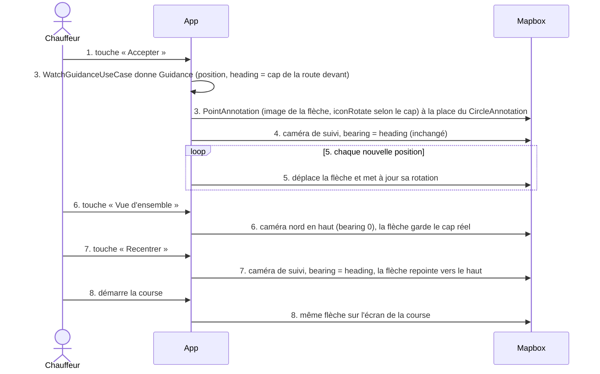

# Flèche du chauffeur sur sa carte de guidage

> Statut : spec écrite le 2026-11-15, image et apparence validées par le user le même jour, image placée dans `assets/icons/driver_arrow.png`. Étapes 1 et 2 codées le 2026-11-15 d'un coup, à la demande du user, pas commitées ; attend son test sur Android (étape 3).

Concerne `taxi-vroom-mobile` seulement : l'API n'a rien à changer. Cette spec vit dans l'API.

Les schémas sont des diagrammes de séquence Mermaid. GitHub les dessine dans les fichiers Markdown ([doc GitHub](https://docs.github.com/en/get-started/writing-on-github/working-with-advanced-formatting/creating-diagrams)). Syntaxe : [doc Mermaid, sequenceDiagram](https://mermaid.js.org/syntax/sequenceDiagram.html). Un point-virgule dans un message coupe la ligne : les schémas n'en ont pas.

## Spec

### Besoin

Demandé par le user le 2026-11-15, en comparant son mode suivi avec Google Maps et avec la démo web de Mapbox : sur la carte de guidage du chauffeur, le taxi est un rond noir qui n'indique pas dans quel sens il roule. Les GPS que les chauffeurs utilisent déjà montrent une flèche orientée dans le sens de la marche : le chauffeur voit d'un coup d'œil où il va, surtout en vue d'ensemble, où la carte ne tourne pas avec lui.

Le reste du mode suivi ne change pas (décisions du 2026-11-15 dans [cadrage-de-la-carte.md](cadrage-de-la-carte.md)) : le taxi reste en bas de l'écran et le zoom continue de cadrer le taxi et le prochain virage.

### Comment ça marche

Chaque situation se lit en deux temps : ce que voit l'utilisateur, étape par étape, puis le schéma de qui parle à qui. Les numéros du schéma renvoient aux étapes. Une étape absente du schéma se passe dans l'app seule.

#### 1. Le chauffeur, en route vers le client puis vers la destination

1. Le chauffeur touche « Accepter » : l'écran de guidage s'ouvre, comme aujourd'hui.
2. Pendant le calcul de l'itinéraire (« Calcul de l'itinéraire… »), aucun repère n'est affiché, comme aujourd'hui.
3. Dès que l'itinéraire est là, son taxi est une flèche à la place du rond noir, au même endroit de l'écran (en bas).
4. En mode suivi, la carte tourne avec lui : la flèche pointe toujours vers le haut de l'écran, dans le sens de la route.
5. Il prend un virage : la carte tourne, la flèche reste pointée vers l'avant.
6. Il touche « Vue d'ensemble » : la carte se remet nord en haut et la flèche montre sa vraie direction (vers la droite s'il roule vers l'est, vers le bas s'il roule vers le sud).
7. Il touche « Recentrer » : la carte tourne de nouveau avec lui, la flèche repointe vers le haut.
8. Le client est à bord, la course démarre : même flèche sur l'écran de la course, jusqu'à « Terminer la course ».

#### 2. Le passager

1. Rien ne change : sur l'écran « c7 arrive dans 2 min », puis pendant la course, il voit toujours le taxi comme un rond noir.

### Décisions prises

| Sujet | Décision |
|---|---|
| Qui voit la flèche | Le chauffeur seulement, sur ses deux écrans de guidage (vers le client, puis vers la destination). Le passager garde le rond noir (validé par le user, 2026-11-15) |
| Place, zoom, inclinaison | Inchangés : taxi en bas de l'écran, zoom qui cadre le taxi et le prochain virage (validé par le user, 2026-11-15, voir cadrage-de-la-carte.md) |
| Plateformes | Android et iOS ; iOS préparé et non testé, faute d'iPhone |
| Source de la position et du cap | Technique, dit au user : la position et le cap du guidage (`Guidance.position`, `Guidance.heading`, cap de la route devant, en degrés depuis le nord dans le sens des aiguilles d'une montre), les mêmes que suit la caméra. Le repère de position intégré de Mapbox (`LocationComponentSettings`, `puckBearingEnabled`) est écarté : il montre la position GPS brute du téléphone, pas celle du guidage, et la flèche pourrait se décaler de la caméra ; la doc 2.31.1 ne dit pas qu'on peut lui donner une autre position ([doc `LocationComponentSettings` 2.31.1](https://pub.dev/documentation/mapbox_maps_flutter/2.31.1/mapbox_maps_flutter/LocationComponentSettings-class.html)) |
| Comment l'afficher | Technique : une annotation de point Mapbox avec une image (`PointAnnotationOptions.image`) tournée par `iconRotate` (« Rotates the icon clockwise », en degrés, [doc `PointAnnotationOptions` 2.31.1](https://pub.dev/documentation/mapbox_maps_flutter/2.31.1/mapbox_maps_flutter/PointAnnotationOptions-class.html)), comme le repère d'arrivée existant (`destination_marker.dart`, PNG 72 × 72 dans `assets/icons/`, prefs `reuseFirst`) |
| Rotation à calculer | Fixé à l'étape 1 après lecture de la doc : pour une icône placée en un point, l'alignement par défaut (`auto`) est celui de l'écran ; `IconRotationAlignment.MAP` aligne l'icône sur la carte ([doc `IconRotationAlignment` 2.31.1](https://pub.dev/documentation/mapbox_maps_flutter/2.31.1/mapbox_maps_flutter/IconRotationAlignment.html), [doc `PointAnnotationManager` 2.31.1](https://pub.dev/documentation/mapbox_maps_flutter/2.31.1/mapbox_maps_flutter/PointAnnotationManager-class.html), `setIconRotationAlignment`). Retenu : alignement `MAP` et `iconRotate = heading` : la flèche montre toujours la vraie direction, en suivi la carte tourne avec le cap donc elle pointe vers le haut. La doc décrit `MAP` pour un point comme un alignement « est-ouest » : à confirmer à l'écran à l'étape 3 |
| Image | Mapbox ne fournit pas d'image de flèche : la doc de `LocationPuck2D` (2.31.1) prévoit une image de cap mais ne dit pas qu'une image par défaut existe ([doc `LocationPuck2D` 2.31.1](https://pub.dev/documentation/mapbox_maps_flutter/2.31.1/mapbox_maps_flutter/LocationPuck2D-class.html)). L'image est ajoutée à l'app (voir À valider, point 1) |
| Tests | Pas de test unitaire : c'est de l'affichage, pas une règle métier (prefs `testsScope`). Vérification à l'écran par le user |

### Règles

| Cas | Résultat |
|---|---|
| Itinéraire pas encore calculé | Aucun repère, comme aujourd'hui |
| Mode suivi | La flèche pointe vers le haut de l'écran |
| Vue d'ensemble | La flèche montre la direction réelle, carte nord en haut |
| Virage | La flèche tourne avec la route |
| Écran du passager | Rond noir, inchangé |

### API

Aucun changement.

### Nouveaux éléments

- Une image de flèche dans `assets/icons/` (le dossier est déjà déclaré dans `pubspec.yaml`).
- `RideMap` (partagée par le passager et le chauffeur) apprend à dessiner le taxi en flèche quand on lui donne un cap ; sans cap (le passager), le rond noir reste. Noms fixés en codant, écart dit au user.
- Aucun Bloc, aucun use case, aucune dépendance.

### Tables touchées

Aucune.

### Hors périmètre

- Le repère du taxi sur l'écran du passager.
- Le zoom, la place du taxi et l'inclinaison du mode suivi.
- Le glissement du repère entre deux positions (aujourd'hui il saute d'une position à la suivante).
- Une voiture en 3D.

## À valider

1. **L'image de la flèche. Validé par le user, 2026-11-15 :** l'icône « navigation » de Material Symbols (Google), la même que celle du bouton « Recentrer » et du bouton d'itinéraire de l'app (`Icons.navigation_outlined`), sous licence Apache 2.0 ([doc Google](https://developers.google.com/fonts/docs/material_symbols)), téléchargée en PNG depuis [fonts.google.com/icons](https://fonts.google.com/icons) par le user, onglet Web. Écartée : Maki, le jeu d'icônes de Mapbox (CC0, [dépôt GitHub](https://github.com/mapbox/maki)), fait pour les points d'intérêt, sans flèche vérifiée.
2. **Son apparence. Validé par le user, 2026-11-15, après son test sur Android (flèche noire trop petite et peu lisible) :** flèche bleue `#0066FF` (`AppConstants.primaryColor`) avec un contour blanc, « comme les GPS que le chauffeur connaît », 72 × 72 px, fichier `assets/icons/driver_arrow.png`, affichée plus grande que l'image (`iconSize` 1,7 en mode suivi, 1,2 en vue d'ensemble : la carte y est dézoomée et une flèche de taille fixe en pixels couvrait les rues et la route, constaté par le user). Tailles et apparence validées à l'œil par le user sur Android, 2026-11-15 : « là ça me paraît good ». Le contour est fabriqué avec ImageMagick sur le PC du user à partir de l'icône « navigation » pleine de Material Symbols (le site ne le permet pas), sans dépendance dans l'app. Risque à juger à l'écran : le trait de la route est du même bleu, la flèche pourrait s'y fondre malgré le contour (version foncée à contour blanc comparée par le user, non retenue).

## Plan

Une étape à la fois, avec une pause et ta validation entre chaque.

### Étape 1 : vérifier la doc et préparer l'image (mobile)

- [x] Lire et citer la doc de `mapbox_maps_flutter` 2.31.1 sur l'alignement de la rotation des annotations de point (`PointAnnotationManager`), et fixer le calcul de `iconRotate` dans cette spec (voir « Rotation à calculer »)
- [x] Ajouter l'image validée (point 1 et 2 d'À valider) dans `assets/icons/` : `driver_arrow.png`, 72 × 72, placée le 2026-11-15

### Étape 2 : la flèche sur la carte du chauffeur (mobile)

- [x] `RideMap` dessine la flèche tournée selon le cap quand un cap lui est donné (`driverHeading`), le rond noir sinon
- [x] `DrivingMap` lui donne le cap du guidage, sur l'écran vers le client et sur celui de la course
- [x] Vérifications : `dart format` et `flutter analyze` sur les fichiers touchés (seulement les 4 remarques `discarded_futures` d'avant), 208 tests verts

### Étape 3 : test par le user (Android)

- [x] Mode suivi : la flèche pointe vers le haut (vu par le user le 2026-11-15) ; dans un virage : pas dit
- [x] Vue d'ensemble : la flèche montre la vraie direction. Taille validée par le user ; direction : sur ses captures du 2026-11-15 elle me semblait pointer vers la gauche alors que le trait repart vers la droite, mais le user a regardé en conduisant : « elle pointe dans le bon sens je crois, j'ai pas testé énormément mais ça à l'air de marcher ». Peu testé : à reconfirmer si un cas étrange apparaît
- [ ] Écran du passager inchangé

### Fin de feature

- [ ] Mettre à jour `.aimemory` du mobile (done, arch ou ltm si une structure est apprise)
- [ ] Commiter quand le user le demande
