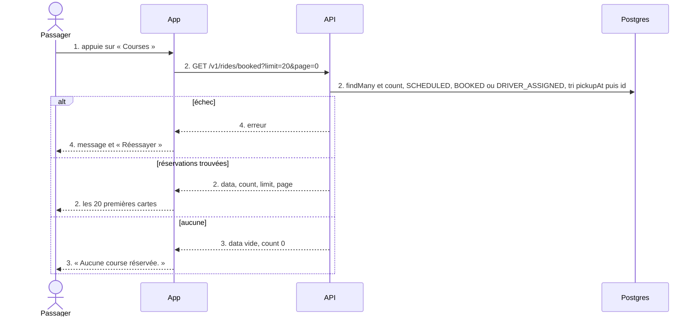
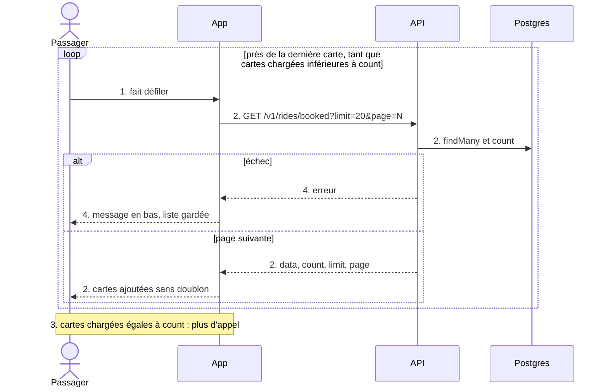
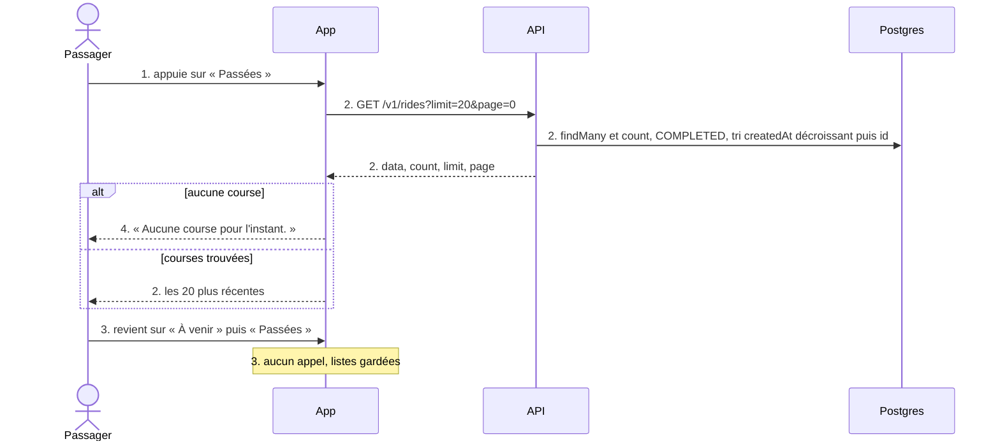
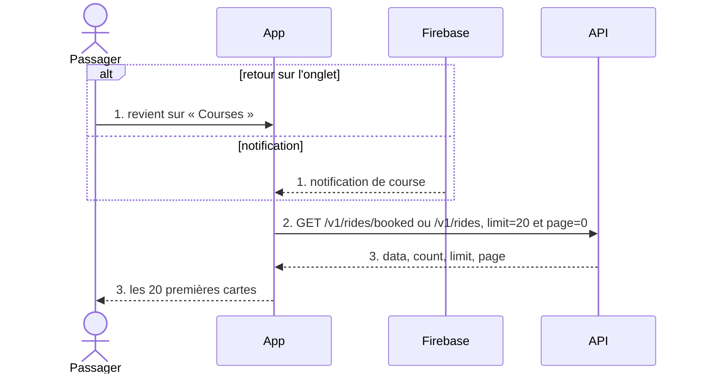
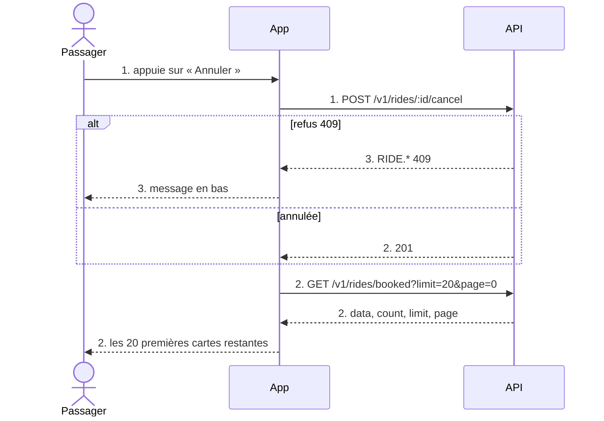

# « Mes courses » par pages

> Statut : codée le 2026-11-14 (étapes 1 à 3 d'un coup, à la demande du user, exception à `stepPause`), pas commitée. API : `tsc` propre, lint à ses 9 erreurs habituelles, `deps:validate` à ses 5 anciennes violations. Mobile : analyse sans remarque nouvelle, 193 tests verts, lint Bloc à ses 6 alertes. Elle attend la migration de l'index (`migration:dev` puis `prisma:generate`, lancées par le user), puis son test sur Android (étape 4).

Concerne `taxi-vroom-api` et `taxi-vroom-mobile`. Cette spec vit dans l'API.

Les schémas sont des diagrammes de séquence Mermaid. GitHub les dessine dans les fichiers Markdown ([doc GitHub](https://docs.github.com/en/get-started/writing-on-github/working-with-advanced-formatting/creating-diagrams)). Syntaxe : [doc Mermaid, sequenceDiagram](https://mermaid.js.org/syntax/sequenceDiagram.html). Un point-virgule dans un message coupe la ligne : les schémas n'en ont pas.

## Spec

### Besoin

Demandé par le user le 2026-11-14 : un passager peut avoir énormément de courses, à venir et passées. On ne les charge pas toutes d'un coup.

Aujourd'hui (code lu le 2026-11-14) :

- « Passées » : `GET /v1/rides` sait déjà paginer (`limit`, `page`, `count`), mais l'app ne demande que les 50 dernières (`_pastRidesLimit`), sans suite : la 51e course n'est jamais visible.
- « À venir » : `GET /v1/rides/booked` renvoie toutes les réservations en un seul tableau, sans limite.
- L'app charge les deux listes en même temps, à chaque arrivée sur l'onglet, même si le passager n'en regarde qu'une.
- La table `rides` n'a aucun index sur `passengerId` : chaque liste lit toute la table.

### Comment ça marche

Chaque situation se lit en deux temps : ce que voit le passager, étape par étape, puis le schéma de qui parle à qui. Les numéros du schéma renvoient aux étapes. Une étape absente du schéma se passe dans l'app seule.

#### 1. Le passager ouvre « Mes courses »

1. Il appuie sur « Courses » : un rond de chargement remplace la liste.
2. Les 20 premières réservations arrivent, la plus proche en premier. Seule la liste « À venir » est chargée.
3. S'il n'en a aucune, il lit « Aucune course réservée. ».
4. Si le chargement échoue, il lit le message d'erreur et le bouton « Réessayer ».

#### 2. Le passager descend dans la liste

1. Il fait défiler : quand il approche de la dernière carte, un petit rond apparaît sous elle.
2. Les 20 suivantes arrivent à la suite des autres. Il ne perd pas sa place.
3. Quand toutes ses courses sont affichées, rien ne s'ajoute : ni rond, ni message.
4. Si le chargement échoue, un message « Chargement impossible » apparaît en bas de l'écran, la liste reste telle quelle, et le prochain défilement essaie encore.

#### 3. Le passager ouvre « Passées »

1. Il appuie sur « Passées » : la première fois, un rond de chargement remplace la liste.
2. Les 20 courses les plus récentes arrivent. Il défile comme en 2.
3. Il revient sur « À venir » puis sur « Passées » : rien ne se recharge, chaque liste garde ce qu'elle a déjà chargé.
4. S'il n'en a aucune, il lit « Aucune course pour l'instant. ».

#### 4. Le passager revient sur « Courses » ou reçoit une notification

1. Il quitte l'onglet « Courses » puis y revient, ou une notification de course arrive.
2. Un rond de chargement remplace la liste visible, jamais l'ancienne liste pendant l'appel.
3. Les 20 premières courses de cette liste arrivent. L'autre liste est oubliée et se rechargera à son ouverture.

#### 5. Le passager annule une réservation

1. Il appuie sur « Annuler » : le bouton montre son rond.
2. La réservation annulée, la liste se recharge depuis le début : un rond de chargement remplace la liste, puis les 20 premières réservations restantes arrivent. Le passager revient en haut de la liste.
3. Si le serveur refuse parce que la réservation a déjà commencé, il lit « Cette réservation a déjà commencé ou a été annulée. » en bas de l'écran, puis la liste se recharge de la même façon.

### Décisions prises

| Sujet | Décision |
|---|---|
| Façon de montrer la suite (validé par le user, 2026-11-14) | Défilement sans fin : la suite arrive toute seule près de la dernière carte, avec un rond dessous. C'est la façon usuelle d'une liste de courses sur mobile, et le passager n'a rien à faire. Alternative écartée : un bouton « Voir plus », un geste de plus à chaque page |
| Taille d'une page | 20 courses, la valeur par défaut déjà utilisée par `PaginatedQueryBase`. L'app envoie `limit=20` elle-même, pour ne pas dépendre de ce défaut |
| Pagination | `page` et `limit`, comme `GET /v1/rides`, la mécanique déjà en place (`PaginatedQueryRequestDto`, `Paginated`). Pas de curseur : un curseur demande un format de plus et la liste d'un passager change peu |
| Ordre stable | Chaque liste ajoute `id` comme second tri : sans lui, deux courses du même instant pourraient passer d'une page à l'autre |
| Course ajoutée pendant le défilement | L'app écarte une carte déjà affichée (même `id`) : au pire, une carte n'apparaît pas avant le prochain rechargement. Pas d'état à garder côté API |
| `GET /v1/rides/booked` change de forme | Un tableau devient `{ data, count, limit, page }`, comme `GET /v1/rides`. L'app et l'API sont livrées ensemble, sans autre client. L'ancienne forme disparaît, sans version de transition |
| Une liste à la fois | « À venir » à l'arrivée, « Passées » à son premier appui. Économise un appel et évite d'attendre une liste que le passager ne regarde pas |
| Fin de liste | `cartes chargées < count` : il reste des pages. Pas de requête vide pour le découvrir |
| Annulation (validé par le user, 2026-11-14) | La liste se recharge depuis le début, avec le rond de chargement, comme après une notification : le passager voit la liste telle que le serveur la connaît. Remplace ma première proposition (retirer la carte sans recharger, pour garder la position de défilement). Conséquence assumée : après de nombreuses pages défilées, il revient en haut |
| Rechargement | Retour sur l'onglet, notification et annulation rechargent la liste visible depuis le début, avec le rond de chargement (décision du user du 2026-11-11 : jamais d'ancienne valeur pendant un appel, voir `mes-courses-a-jour.md`) |
| Chargement d'une page suivante (validé par le user, 2026-11-14) | Un rond sous la dernière carte, jamais l'écran entier : la règle `loaderAlways` vise l'ancienne valeur laissée à l'écran pendant l'attente de sa remplaçante. Ici les cartes affichées restent exactes, la page ajoutée ne remplace rien |
| Écran trop court pour déclencher le défilement | Si les 20 premières cartes ne remplissent pas l'écran et qu'il en reste, la page suivante se charge d'elle-même |
| Index (choix technique, du 2026-11-14) | `@@index([passengerId])` sur `rides` : l'index est exprimable dans `schema.prisma` (`prismaOnlySchema`), les deux listes filtrent toutes sur `passengerId`, et chaque estimation abandonnée ajoute une ligne (`estimatedRidesPileUp`) |
| Tests | API : aucun (`noBackendTests`). Mobile : règle métier pure en TDD, l'ajout d'une page à la liste (sans doublon) et « reste-t-il des pages » |

### Règles

| Cas | Résultat |
|---|---|
| Passager sans aucune course | « Aucune course réservée. » ou « Aucune course pour l'instant. » |
| Dernière page de 20 courses pile | `count` le dit : aucun appel de plus |
| Page suivante en échec | Message en bas, liste gardée, nouvel essai au prochain défilement |
| `page` au-delà de la fin | L'API renvoie `data` vide, l'app s'arrête |
| Notification ou annulation pendant une page en cours | Le rechargement depuis le début prend le dessus, la page en cours est abandonnée |

### API

| Route | Changement |
|---|---|
| `GET /v1/rides/booked?limit&page` | Paginée, réponse `{ data, count, limit, page }` (était un tableau). Tri : `pickupAt` croissant, puis `id` |
| `GET /v1/rides?limit&page` | Inchangée. Tri : `createdAt` décroissant, puis `id` |

### Nouveaux éléments

**API** (chercher l'existant d'abord, `reuseFirst` : aucune nouvelle classe de pagination) :

- `FindMyBookingsQuery` passe de `QueryBase` à `PaginatedQueryBase`, avec `Paginated<PassengerBooking>` en retour, comme `FindMyRidesQuery`. Elle garde son propre appel Prisma (`cqrsRead`, `readNeverDomain`) ;
- son contrôleur reçoit `PaginatedQueryRequestDto` et renvoie un DTO paginé dont les champs sont listés un à un (`responseWhitelist`), sur le modèle de `PastRidePaginatedResponseDto` ;
- les deux requêtes ajoutent `id` au tri ;
- `@@index([passengerId])` sur `Ride` dans `schema.prisma`.

**Mobile** (chercher l'existant d'abord, `reuseFirst`) :

- chaque liste garde ses cartes, sa page et son `count` : une entité à nom clair (`namedTypes`) qui porte la règle « ajouter une page sans doublon » et « reste-t-il des pages » (`logicInUseCases`, `helpersOnModel`), en TDD ;
- les datasources prennent la page et renvoient des modèles, le dépôt les passe par `toDomain()` et renvoie `Result<T>` (`apiMapping`, `resultErrors`) ;
- `RideHistoryBloc` (événements dans son fichier scellé, `blocOnly`) : chargement de la liste visible, de la page suivante, état « page suivante en cours » ;
- `ride_history_tab` : défilement qui demande la page suivante, rond sous la dernière carte, composants `shadcn_flutter` (`shadcnOnly`) ;
- `LoadRideHistoryUseCase` prend la liste et la page, et ce qui change de constructeur passe par `app.dart` et `AuthNavigator` comme aujourd'hui (`noDiContainer`).

### Tables touchées

`rides` : un index sur `passengerId`. Une migration, créée par `migration:dev`, donnée en texte au user (`npmSelfRun`). Pas de nouvelle colonne.

### Hors périmètre

- Recherche ou filtre dans les courses.
- Défilement pour le chauffeur (« Réservations ») : autre écran, autre route, spec `reservations-chauffeur-par-pages.md` (demandée par le user le 2026-11-14).
- Pagination par curseur.

### Limites connues

- Course terminée pendant le défilement : elle peut décaler la suite d'une carte. Une carte déjà vue ne revient pas, une carte peut manquer jusqu'au prochain rechargement.

## À valider

1. **Défilement sans fin ou bouton « Voir plus » ? Validé par le user, 2026-11-14 : défilement sans fin.**
2. **Le rond sous la dernière carte pendant une page suivante ? Validé par le user, 2026-11-14 : il lui convient.** Lecture retenue de `loaderAlways` : elle vise le remplacement d'une valeur, pas l'ajout d'une page.

Plus rien à valider : la spec attend le go du user pour l'étape 1.

## Plan

Une étape à la fois, avec une pause et ta validation entre chaque.

### Étape 1 : API

- [x] Lire la doc officielle de Prisma sur `findMany` (`skip`, `take`), `count` et `@@index`, et la citer ici (`officialDocs`). Ce qu'elle dit et ne dit pas : la page v6 de la pagination documente `skip` et `take` avec un seul champ d'`orderBy`, et ne montre pas l'`orderBy` multiple ; la page actuelle de `prisma.io` décrit une autre API (`.offset`, `.limit`, `db.orm`) qui n'est pas celle du client 7.10.0 installé ; la page des index ne dit pas si une relation reçoit un index automatique sur PostgreSQL. L'`orderBy` en tableau est confirmé par les types générés du client installé (`src/generated/prisma/models/Ride.ts` : `orderBy?: RideOrderByWithRelationInput | RideOrderByWithRelationInput[]`), et l'absence d'index par le schéma et les migrations (aucun `CREATE INDEX` sur `rides`)
- [x] `FindMyBookingsQuery` paginée, DTO de réponse paginé, contrôleur
- [x] `id` en second tri des deux requêtes
- [x] `@@index([passengerId])` dans `schema.prisma`
- [ ] Le user lance `npm run migration:dev -- --name ride_passenger_index` puis `npm run prisma:generate`, et me dit le résultat
- [x] `npx tsc --noEmit` (propre), `npm run lint` (9 erreurs habituelles), `npm run deps:validate` (5 anciennes violations), lancés par moi

### Étape 2 : mobile, données et règle métier

- [x] Chercher l'existant (liste paginée, `coreShared`, `arch`) avant d'écrire : rien de paginé dans l'app
- [x] Test d'abord : `PagedList` (`hasMore`, `nextPage`, `appended` sans doublon, page vide qui arrête), 8 tests, rouge puis verts
- [x] Datasources (`PagedListModel`), dépôt (`getBookings`, `getPastRides`, `Result<T>`) et deux cas d'usage (`LoadBookingsUseCase`, `LoadPastRidesUseCase`, `splitUseCases`), threadés par `app.dart`, `AuthNavigator` et `PassengerHomePage`. Remplace `RideHistory` et `LoadRideHistoryUseCase`, supprimés

### Étape 3 : mobile, bloc et écran

- [x] Doc de Flutter 3.47.2 lue : le cookbook des longues listes (`ListView.builder` crée les cartes au défilement) et le code installé de `ScrollMetrics.extentAfter` et de `ScrollMetricsNotification` (envoyée quand les dimensions changent sans défilement : sert au cas « écran trop court »). Le cookbook ne traite pas la détection de fin de liste : le seuil de 400 pixels (environ deux cartes) est mon choix. Le rond de chargement est le `CircularProgressIndicator` de `shadcn_flutter` déjà employé dans l'écran
- [x] `RideHistoryBloc` : liste visible dans l'état (`shown`), première page, page suivante (ignorée si une autre charge a pris le dessus ou si le passager a changé de liste), rechargement depuis le début à l'annulation, à la notification et au retour sur l'onglet, chaque liste garde ses pages
- [x] `ride_history_tab` : onglets pilotés par le bloc, défilement, rond sous la dernière carte, message « Chargement impossible » en échec
- [x] `dart format` sur les fichiers touchés seulement, `flutter analyze` sans remarque nouvelle, 193 tests verts, lint Bloc à ses 6 alertes

### Étape 4 : test (par le user)

- [ ] Beaucoup de courses à venir et passées en base : défilement jusqu'à la fin, rien en double
- [ ] Annuler une réservation au milieu de la liste : la liste se recharge depuis le début, sans la carte annulée
- [ ] Échec réseau pendant une page : message, liste gardée, reprise au défilement

### Fin de feature

- [ ] Mettre à jour `.aimemory` des deux dépôts (arch, hyp, done, ltm passengerApp : « last 50, no paging » devient faux), et `mes-courses-a-jour.md` (le rechargement n'est plus « les deux listes »)
- [ ] Commiter quand le user le demande

## Sources

- [Prisma, pagination](https://www.prisma.io/docs/orm/prisma-client/queries/pagination), à relire pour la version 7.10.0 à l'étape 1
- Code lu le 2026-11-14 : `find-my-rides.query-handler.ts`, `find-my-bookings.query-handler.ts`, `paginated-query.request.dto.ts`, `schema.prisma` (modèle `Ride`, aucun `@@index`), `ride_history_bloc.dart`, `ride_history_tab.dart`, `ride_remote_datasource.dart`, `ride_booking_remote_datasource.dart`
