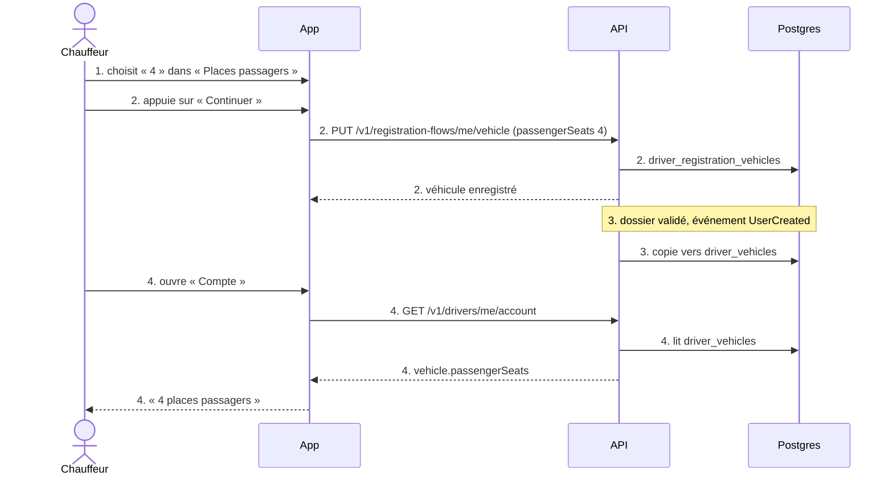
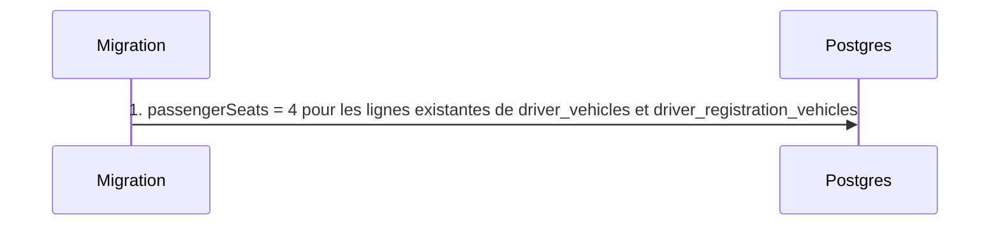
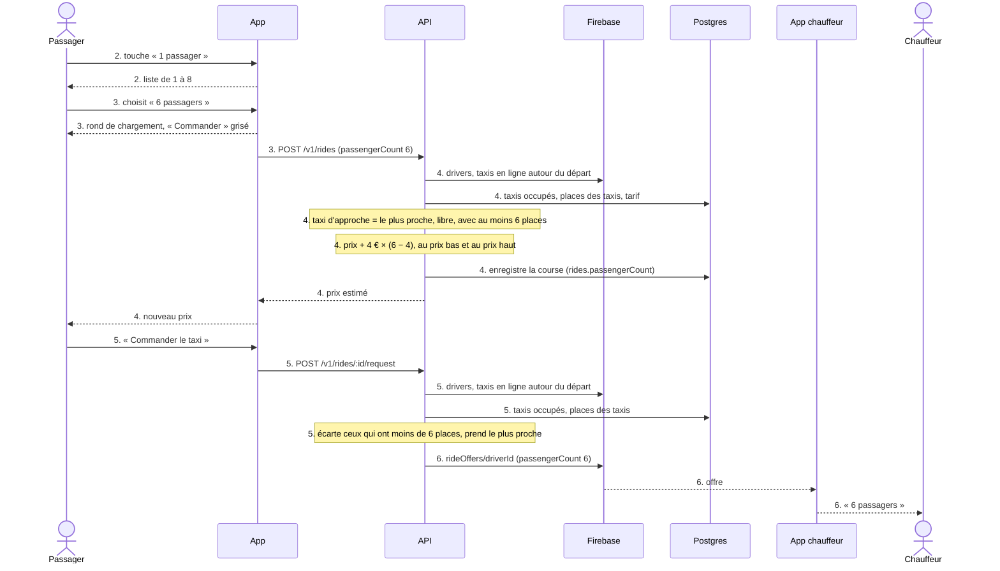
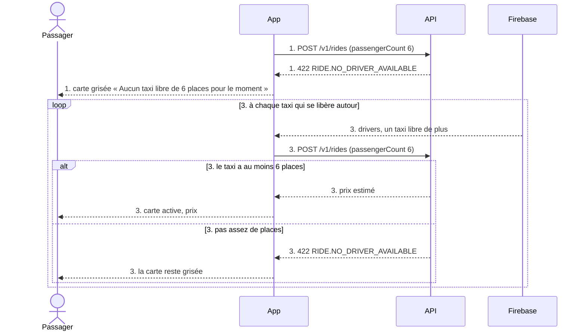
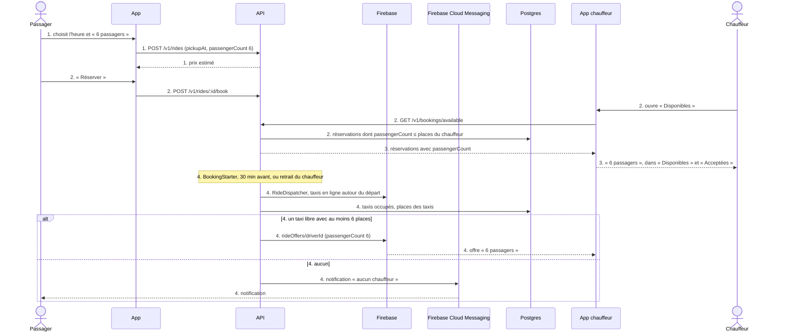
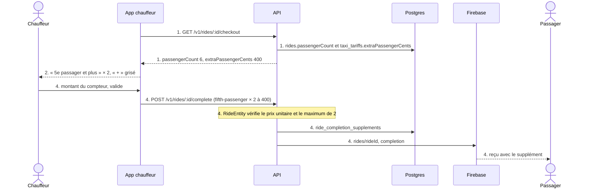

# Nombre de passagers

> Statut : codé le 2026-11-13 (étapes 1 à 3, d'un coup, à la demande du user), pas commité. Mobile : analyse et 158 tests verts. API : pas encore vérifiée (`tsc`, `lint`, `deps:validate`), elle attend la migration et `prisma:generate` du user, puis son test sur Android (étape 4).

Concerne `taxi-vroom-api` et `taxi-vroom-mobile`. Cette spec vit dans l'API.

Les schémas sont des diagrammes de séquence Mermaid. GitHub les dessine dans les fichiers Markdown ([doc GitHub](https://docs.github.com/en/get-started/writing-on-github/working-with-advanced-formatting/creating-diagrams)). Syntaxe : [doc Mermaid, sequenceDiagram](https://mermaid.js.org/syntax/sequenceDiagram.html). Un point-virgule dans un message coupe la ligne : les schémas n'en ont pas.

## Spec

### Besoin

Demandé par le user le 2026-11-13. Sur le choix du taxi, le bouton « 1 passager » ne fait rien (`taxi_choice_page.dart`, « The passenger count is not built yet »). L'API ne connaît pas le nombre de passagers, et le chauffeur voit toujours « 1 passager, 0 bagage » : la valeur est écrite en dur dans l'app (`ride_request_remote_datasource.dart`, `driver_booking_model.dart`). À la fin de la course, la ligne « 5e passager et plus » du chauffeur est simulée (`DriverRideRemoteDataSourceFake.getCheckout`).

Le passager doit pouvoir choisir combien de personnes voyagent, et tout ce qui suit dans la commande ou la réservation doit en tenir compte, jusqu'à la fin de la course.

### Comment ça marche

Chaque situation se lit en deux temps : ce que voit l'utilisateur, étape par étape, puis le schéma de qui parle à qui. Les numéros du schéma renvoient aux étapes. Une étape absente du schéma se passe dans l'app seule.

#### 1. Le chauffeur, à l'inscription

1. Sur « Votre taxi », sous la commune, le chauffeur voit un nouveau champ « Places passagers » avec huit boutons, de « 1 » à « 8 », comme les boutons de couleur juste au-dessus. Le champ est obligatoire : « Continuer » reste grisé tant qu'aucun bouton n'est choisi.
2. Il appuie sur « Continuer » : le bouton montre le rond de chargement, comme aujourd'hui, et le nombre de places est enregistré avec le reste du véhicule.
3. Quand son dossier est validé, ses places sont copiées avec le véhicule.
4. Dans « Compte », après le rond de chargement de chaque arrivée sur l'onglet, la carte du véhicule affiche aussi « 4 places passagers », en lecture seule.



#### 2. Les chauffeurs déjà inscrits

1. Ils n'ont rien à faire : leur taxi a 4 places.



#### 3. Le passager, pour une course immédiate

1. Sur « Votre taxi », le bouton affiche « 1 passager », comme aujourd'hui.
2. Il touche le bouton : une petite liste s'ouvre sous le bouton, de « 1 passager » à « 8 passagers ». C'est le `showDropdown` de shadcn, comme le choix de période de « Gains ».
3. Il choisit « 6 passagers ». Le bouton affiche « 6 passagers ». La carte « Taxi » montre le rond de chargement à la place du prix, et « Commander le taxi » est grisé pendant le calcul.
4. Le nouveau prix s'affiche. À partir de 5 passagers, il comprend 4 € par passager en plus du 4e : 8 € de plus pour 6 passagers. Le supplément s'ajoute au prix bas et au prix haut.
5. Il appuie sur « Commander le taxi ». La course n'est proposée qu'aux taxis libres qui ont au moins 6 places, le plus proche d'abord.
6. Le chauffeur reçoit l'offre avec « 6 passagers » au lieu de « 1 passager ».
7. La suite de la course ne change pas, jusqu'à la fin de course (situation 6).



#### 4. Le passager, quand aucun taxi libre n'a assez de places

1. La carte « Taxi » est grisée, comme quand aucun taxi n'est libre, mais elle dit « Aucun taxi libre de 6 places pour le moment ». « Commander le taxi » est grisé.
2. Il peut choisir moins de passagers, ou changer l'heure pour réserver.
3. Si un taxi se libère, l'app recalcule le prix d'elle-même, comme aujourd'hui. Si ce taxi n'a pas assez de places, la carte reste grisée.



#### 5. Le passager, pour une réservation

1. Il choisit l'heure et le nombre de passagers sur « Votre taxi », dans l'ordre qu'il veut. Chaque changement recalcule le prix, avec le rond de chargement.
2. Il appuie sur « Réserver ». La réservation n'apparaît dans « Disponibles » que pour les chauffeurs qui ont assez de places. Il peut réserver même si aucun chauffeur inscrit n'a assez de places.
3. Le chauffeur voit « 6 passagers » sur la réservation, dans « Disponibles » et « Acceptées ».
4. Si aucun chauffeur ne l'a acceptée 30 min avant, ou si le chauffeur engagé se retire, la course est proposée aux taxis libres qui ont assez de places. Si aucun n'en a, le passager reçoit la notification « aucun chauffeur », comme aujourd'hui.



#### 6. Le chauffeur, à la fin de la course

1. Sur « Fin de course », le chauffeur voit le rond de chargement, comme aujourd'hui, puis la ligne « 5e passager et plus », à 4 €.
2. Pour une course de 6 passagers, la ligne est déjà à 2 (6 − 4) et le total compte 8 € de plus. Le chauffeur peut baisser jusqu'à 0, puisque le supplément est facultatif. Il ne peut pas dépasser 2 : le bouton « + » est grisé.
3. Pour une course de 4 passagers ou moins, la ligne n'apparaît pas.
4. Il tape le montant du compteur et valide, comme aujourd'hui. Le passager voit le total avec le supplément sur son reçu.



#### 7. Le passager revient à l'accueil

1. Le nombre de passagers revient à 1, comme l'heure revient à « Maintenant ». Ça se passe dans l'app seule : `PassengerFlowBloc._home()`.

### Décisions prises

| Sujet | Décision |
|-------|----------|
| Places du taxi (validé par le user, 2026-11-13) | On demande au chauffeur le nombre de places de son taxi. Seul un taxi qui a assez de places pour tous les passagers peut recevoir la course. |
| Pas assez de places (validé par le user, 2026-11-13) | Si aucun taxi n'a assez de places, on le dit au passager, et rien de plus. On ne commande jamais plusieurs taxis pour un même trajet. |
| Supplément passager dans le prix (validé par le user, 2026-11-13) | Le prix estimé ajoute 4 € par passager à partir du 5e : 4 € × (passagers − 4), rien jusqu'à 4 passagers. Le supplément est facultatif pour le chauffeur (« pourra être perçu »), mais l'estimation l'inclut pour que le passager n'ait pas de mauvaise surprise. Sources : règle générale 4 € à partir du 5e ([service-public.gouv.fr, F34349](https://www.service-public.gouv.fr/particuliers/vosdroits/F34349), arrêté national du 24 décembre 2025) ; Bas-Rhin 4 € selon trois sites de taxis ([taxi-grand-est.fr](https://www.taxi-grand-est.fr/blog/tarifs-taxi-bas-rhin-2026), [strasbourg-taxi.fr](https://www.strasbourg-taxi.fr/tarifs), [centraledetaxi.com](https://www.centraledetaxi.com/tarifs-taxi-2026)) ; l'arrêté préfectoral du Bas-Rhin n'a pas été trouvé en ligne, le user accepte ces sources de seconde main. |
| De 1 à 8 (validé par le user, 2026-11-13) | Le passager choisit de 1 à 8 passagers, le chauffeur déclare de 1 à 8 places : la loi limite un taxi à 8 places passagers (voir « Règles »). |
| Chauffeurs déjà inscrits (validé par le user, 2026-11-13) | Ils reçoivent 4 places par défaut. Ce ne sont que des comptes de test, rien n'est en production. Le nombre de places reste en lecture seule dans « Compte ». |
| Message sans taxi assez grand (validé par le user, 2026-11-13) | La carte grisée dit « Aucun taxi libre de 6 places pour le moment », avec le nombre choisi. Écarté : garder « Aucun taxi libre pour le moment », qui est faux quand des petits taxis sont libres. |
| Réservation sans taxi assez grand (validé par le user, 2026-11-13) | Le passager peut réserver pour 7 même si aucun chauffeur inscrit n'a 7 places, comme il peut déjà réserver sans aucun chauffeur en ligne. 30 min avant, si personne ne l'a prise, il reçoit « aucun chauffeur ». Écarté : vérifier à la réservation qu'un taxi assez grand existe, car un chauffeur inscrit plus tard pourrait la prendre. |
| Places dans « Compte » (validé par le user, 2026-11-13) | La carte du véhicule affiche « 4 places passagers », en lecture seule, pour que le chauffeur sache pourquoi il ne reçoit pas les grands groupes. |
| Supplément à la fin de course (validé par le user, 2026-11-13) | Le supplément du 5e passager et plus est réel aussi sur « Fin de course » : son prix vient du tarif de la course, et son nombre du nombre de passagers (situation 6). Écarté : le laisser hors périmètre, avec un reçu final sans supplément alors que le prix estimé l'inclut. |
| Ligne « 5e passager et plus » à la fin de course (validé par le user, 2026-11-13) | Déjà remplie avec passagers − 4. Le chauffeur peut la baisser jusqu'à 0, sans pouvoir dépasser ce nombre. Elle est cachée jusqu'à 4 passagers. Écarté : la laisser à 0, au risque que le chauffeur oublie un supplément que le passager a vu dans le prix estimé. |
| Le champ « Places passagers » (choix technique de Claude) | Le chauffeur choisit parmi huit boutons, comme la couleur juste au-dessus : un seul appui, tous les choix visibles. *(Le `ChoiceButton` déjà utilisé par `_buildColors()` dans `driver_vehicle_page.dart`, construit sur shadcn_flutter 0.0.51. Écarté : le `Select` de shadcn (`lib/src/components/form/select.dart`), qui demande deux appuis pour huit choix.)* |
| Le montant du supplément vient du tarif (choix technique de Claude) | Le passager voit 4 € par passager en plus dans le Bas-Rhin. Le montant est gardé avec chaque arrêté, comme la prise en charge, parce qu'il change d'un département à l'autre : 5,50 € à Paris. *(Postgres : colonne `extraPassengerCents` dans `taxi_tariffs`, 400 pour le Bas-Rhin ; le seuil de 4 passagers est une règle de `RideEntity`)* |
| Les places sont lues dans Postgres (choix technique de Claude) | Le chauffeur ne peut pas changer ses places depuis l'app : l'API les lit dans sa base, jamais dans Firebase, où l'app chauffeur écrit. *(Module driver : `GetDriverSeatsQuery` pour plusieurs chauffeurs en une requête, envoyée par le module ride comme `GetDriverDocumentStatesQuery`)* |
| La règle des places, côté écriture (choix technique de Claude) | Le choix du taxi le plus proche écarte ceux qui ont trop peu de places, au même endroit que ceux qui sont occupés. *(`DriverCandidate.passengerSeats`, filtré par `RideEntity` dans `approachingDriver` et `offerToClosestDriver`, utilisés par `EstimateRideService` et `RideDispatcher`)* |
| La règle des places, côté lecture (choix technique de Claude) | « Disponibles » ne montre au chauffeur que les réservations qui tiennent dans son taxi. *(`FindAvailableBookingsQuery` lit les places du chauffeur avec `GetDriverSeatsQuery` et ajoute `passengerCount: { lte: places }` à sa propre requête Prisma. Elle n'appelle jamais `RideEntity` : règle `readNeverDomain`.)* |
| Accepter une réservation trop grande (choix technique de Claude) | Le chauffeur ne voit jamais ce refus : « Disponibles » ne lui montre que les réservations qui tiennent dans son taxi, et ni ses places ni le nombre de passagers ne changent ensuite. C'est une garde du serveur contre un appel fait hors de l'app. *(`RideEntity.acceptBooking` reçoit les places du chauffeur et rend `Err(RideNotEnoughSeatsError)`, code `RIDE.NOT_ENOUGH_SEATS`, 409, dans `ride.errors.ts` ; `AcceptBookingService` n'a pas de `if`, il passe les places lues par `GetDriverSeatsQuery`)* |
| Le supplément vérifié à la fin de course (choix technique de Claude) | Le chauffeur ne voit jamais ce refus : l'app ne laisse pas dépasser le maximum et prend le prix donné par l'API. C'est une garde du serveur, qui fait confiance à l'app pour les autres suppléments (hypothèse `supplementsTrustClient`). *(`RideEntity.complete` refuse une ligne `fifth-passenger` dont le prix n'est pas `extraPassengerCents` ou dont le nombre dépasse `passengerCount − 4` : `Err(RideInvalidPassengerSupplementError)`, code `RIDE.INVALID_PASSENGER_SUPPLEMENT`, 422. Le repository lit `extraPassengerCents` par `rides.tariffId`, sans colonne en double.)* |
| Ce que dit la carte « Taxi » (trouvé en codant, à confirmer par le user) | Sous « Taxi », la carte disait « 4 places », ce qui devient faux dès que le passager choisit 6. Elle dit maintenant « 6 passagers » (« 1 passager » pour un seul), le nombre choisi. Pour 1 passager, le message sans taxi libre reste « Aucun taxi libre pour le moment » : « de 1 place » serait étrange. *(`taxi_offer_remote_datasource.dart` : `description` ; `taxi_choice_page.dart` : `_buildNoFreeTaxi`)* |
| Un taxi libre mais trop petit (bug trouvé au test du user, 2026-11-13, corrigé) | Avec 5 passagers, la carte restait en chargement sans fin : les taxis à 4 places sont libres mais refusés par l'API, et l'app croyait qu'un taxi venait de se libérer, estimait de nouveau, était refusée, et recommençait. Maintenant, la carte reste grisée (situation 4, étape 3), et seule l'arrivée d'un taxi qui n'était pas libre au moment du refus relance l'estimation. *(`TaxiChoiceBloc._watchFreeTaxis` garde les taxis libres de la première réponse ; règle `WatchNearbyTaxisUseCase.hasNewTaxi`, 4 tests)* |
| Chauffeur sans véhicule (choix technique de Claude, trouvé en codant) | Un chauffeur inscrit avant l'étape « Votre taxi » n'a aucune ligne dans `driver_vehicles` : il n'a donc pas de places connues. Il ne reçoit aucune course, aucune offre et ne voit aucune réservation dans « Disponibles », comme un taxi à 0 place. Les 4 places par défaut ne s'appliquent qu'aux véhicules déjà enregistrés. Ce sont des comptes de test, mais à savoir si un test d'offre ne parvient pas à un ancien chauffeur. *(`GetDriverSeatsQuery` ne renvoie rien pour lui ; `DriverCandidate.passengerSeats` vaut 0 ; `passengerCount: { lte: 0 }` dans « Disponibles » ; `acceptBooking` reçoit 0)* |
| Pas de valeur par défaut permanente (choix technique de Claude) | Rien de visible. *(Les colonnes nouvelles n'ont pas de `@default` dans `schema.prisma` : une valeur oubliée par le code fait échouer l'écriture au lieu de mettre 4 places en silence. Les lignes existantes sont remplies une fois, dans la migration éditée à la main, comme le prévoit le flux de migration du repo : `--create-only`, puis édition. La [doc Prisma](https://www.prisma.io/docs/orm/prisma-migrate/workflows/customizing-migrations) le dit : « The rows already in your `user` table have no `displayName`, so you have to decide what those rows get. »)* |

### Règles

- Un taxi a au plus 8 places passagers : « Les taxis sont des véhicules automobiles comportant, outre le siège du conducteur, huit places assises au maximum » (code des transports, article L3121-1, cité par la [réponse du ministère au Sénat, 2022](https://www.senat.fr/questions/base/2022/qSEQ220701850.html)). Un groupe de plus de 8 ne peut donc jamais tenir dans un taxi.
- Un taxi peut recevoir une course seulement si ses places sont au moins égales au nombre de passagers. Cela vaut pour l'estimation, l'offre, les réservations disponibles, l'acceptation d'une réservation et la recherche de secours d'une réservation.
- Supplément estimé = `extraPassengerCents` × max(0, passagers − 4). Il s'ajoute au prix bas et au prix haut, après le minimum de perception.
- À la fin de course, la ligne « 5e passager et plus » vaut `extraPassengerCents` l'unité, de 0 à passagers − 4 fois.
- Le nombre de passagers ne change plus après la commande ou la réservation.
- Une course enregistrée avant cette feature compte 1 passager.
- Chaque changement du nombre de passagers recalcule le prix, donc crée une nouvelle course estimée en base. Les courses estimées abandonnées ne sont jamais nettoyées (hypothèse `estimatedRidesPileUp`, ouverte) : cette feature en crée davantage. Accepté pour la v1, sans nettoyage ajouté ici.

### API

```
POST /v1/rides                       body + passengerCount (entier 1 à 8, obligatoire)
                                     422 RIDE.NO_DRIVER_AVAILABLE aussi quand aucun taxi libre n'a assez de places
GET  /v1/bookings/available          chaque réservation + passengerCount, seules celles qui tiennent dans le taxi
GET  /v1/bookings/accepted           chaque réservation + passengerCount
POST /v1/rides/:id/booking/accept    409 RIDE.NOT_ENOUGH_SEATS (garde, jamais vue dans l'app)
GET  /v1/rides/:id/checkout          nouveau, chauffeur de la course seulement : { passengerCount, extraPassengerCents }
POST /v1/rides/:id/complete          422 RIDE.INVALID_PASSENGER_SUPPLEMENT (garde, jamais vue dans l'app)
PUT  /v1/registration-flows/me/vehicle   body + passengerSeats (entier 1 à 8, obligatoire)
GET  /v1/registration-flows/me       vehicle + passengerSeats
GET  /v1/drivers/me/account          vehicle + passengerSeats
Firebase rideOffers/<driverId>       + passengerCount
```

`passengerCount` et `passengerSeats` sont obligatoires : l'app et l'API sont livrées ensemble, aucune ancienne version de l'app n'est en circulation.

### Nouveaux éléments

API :
- `GetDriverSeatsQuery` (module driver) : les places de plusieurs chauffeurs en une requête.
- `GetRideCheckoutQuery` (module ride) et `GET /v1/rides/:id/checkout` : lecture directe de `rides` et `taxi_tariffs`.
- `RideEntity` : `passengerCount`, le supplément dans l'estimation, le filtre des places dans le choix du chauffeur, la garde de `acceptBooking`, la vérification du supplément dans `complete`.
- Erreurs `RideNotEnoughSeatsError` et `RideInvalidPassengerSupplementError` dans `ride.errors.ts`.

Mobile :
- Le bouton du nombre de passagers, à côté de `PickupTimeChip`, avec sa liste de 1 à 8 (`showDropdown`).
- `TaxiChoiceBloc` garde le nombre de passagers et le passe à `LoadTaxiChoiceUseCase`, qui recalcule le prix : la logique reste dans le use case.
- « Places passagers » sur « Votre taxi » de l'inscription chauffeur (`ChoiceButton`), et dans la carte du véhicule de « Compte ».
- Le nombre de passagers lu depuis l'offre et les réservations, au lieu des valeurs écrites en dur.
- `RideCheckoutRemoteDataSourceImpl` sur `GET /v1/rides/:id/checkout`. `FareSupplement` gagne un maximum. `RideCheckout.withCount` ne dépasse jamais ce maximum, et le nombre de départ est le maximum.

### Tables touchées

- `rides` : `passengerCount Int`. Les courses existantes reçoivent 1 dans la migration.
- `taxi_tariffs` : `extraPassengerCents Int`. Les lignes existantes, aujourd'hui la seule du Bas-Rhin, reçoivent 400 dans la migration. La ligne du Bas-Rhin n'est pas dans le seed, elle est insérée à la main en SQL après un reset : cette insertion doit maintenant donner aussi `extraPassengerCents = 400`. La mémoire `ltm/n/priceEstimate.md` le notera à la fin de la feature.
- `driver_registration_vehicles` et `driver_vehicles` : `passengerSeats Int`. Les lignes existantes reçoivent 4 dans la migration.

### Hors périmètre

- Commander plusieurs taxis pour un même groupe (décision du user, 2026-11-13).
- Les bagages : la notion n'existe plus dans l'app (décision du user, 2026-11-13, « on s'en fiche de la notion de bagage, supprime-la totalement »). Plus de « 0 bagage » chez le chauffeur, plus de ligne « Bagage encombrant » à la fin de course, plus de compliment « Aide bagages », plus de mot « bagages » dans l'aide sur le prix. Aucune feature de bagages n'est prévue.
- Changer ses places depuis « Compte » (décision du user, 2026-11-13).
- Afficher le nombre de passagers dans « Mes courses » ou sur l'écran de course du passager.
- Nettoyer les courses estimées abandonnées (hypothèse `estimatedRidesPileUp`).

## À valider

1. **Le supplément passager dans le prix estimé. Validé par le user, 2026-11-13 :** 4 € par passager à partir du 5e, inclus dans l'estimation (voir « Décisions prises »).
2. **De 1 à 8. Validé par le user, 2026-11-13** (voir « Décisions prises »).
3. **Chauffeurs déjà inscrits. Validé par le user, 2026-11-13 :** 4 places par défaut (voir « Décisions prises »).
4. **Le message quand aucun taxi libre n'a assez de places. Validé par le user, 2026-11-13** (voir « Décisions prises »).
5. **Une réservation que personne ne peut prendre. Validé par le user, 2026-11-13** (voir « Décisions prises »).
6. **Les places dans « Compte ». Validé par le user, 2026-11-13** (voir « Décisions prises »).
7. **La ligne « 5e passager et plus » à la fin de course. Validé par le user, 2026-11-13** (voir « Décisions prises »).
8. **La ligne « Bagage encombrant » à la fin de course. Validé par le user, 2026-11-13 :** elle restait simulée jusqu'à une feature des bagages ; **remplacé le 2026-11-13 :** le user supprime totalement la notion de bagage de l'app, la ligne est donc retirée (voir « Hors périmètre »). Écarté : la retirer, ce qui changerait l'écran pour une raison sans rapport avec les passagers ; écrire la spec des bagages avant de coder.
9. **Tout coder d'un coup. Demandé par le user, 2026-11-13** : les étapes 1 à 3 sont codées sans pause entre elles, exception à `stepPause` comme pour les documents du chauffeur. Je m'arrête seulement pour la migration, que le user lance.

## Plan

### Étape 1 : l'API

- [x] `schema.prisma` : les colonnes de « Tables touchées », sans `@default` (écrit le 2026-11-13). **Reste au user** : créer la migration avec `--create-only`, puis je l'édite pour remplir les lignes existantes (1 passager, 4 places, 400) ; le user l'applique, puis lance `prisma:generate`
- [x] Inscription : `passengerSeats` dans `PUT me/vehicle`, l'entité, le mapper, `GET registration-flows/me` et la copie vers `driver_vehicles` (codé)
- [x] Module driver : `GetDriverSeatsQuery` ; `passengerSeats` dans `GET drivers/me/account` (codé)
- [x] Module ride, écriture : `passengerCount` dans l'estimation, le supplément dans `taxi-fare.ts`, le filtre des places dans `RideEntity` (utilisé par `EstimateRideService` et `RideDispatcher`), la garde de `acceptBooking`, la vérification du supplément dans `complete`, les deux erreurs (codé)
- [x] Module ride, lecture : le filtre des places dans la requête de `FindAvailableBookingsQuery`, `passengerCount` dans les réponses des réservations, `GetRideCheckoutQuery` et sa route (codé)
- [x] `passengerCount` dans `rideOffers/<driverId>` (codé)
- [x] `tsc`, `lint`, `deps:validate` : `tsc` propre, `lint` aux 9 erreurs habituelles (aucune dans les fichiers de cette feature), `deps:validate` aux 5 anciennes violations, rien de nouveau (2026-11-13, après la migration `20261113062558_passenger_count_and_seats` et `prisma:generate` du user)

### Étape 2 : le passager (mobile)

- [x] Le bouton et sa liste de 1 à 8, `TaxiChoiceBloc` et `LoadTaxiChoiceUseCase`, le recalcul avec le rond de chargement, `passengerCount` envoyé à `POST /v1/rides` (codé : `PassengerCountChip`, `PassengerFlowState.passengerCount`, événement `PassengerCountChanged`, comme l'heure de prise en charge)
- [x] Le message « Aucun taxi libre de N places pour le moment » (codé ; pour 1 passager, le message reste « Aucun taxi libre pour le moment »)
- [x] Retour à 1 passager quand le passager revient à l'accueil (codé : `PassengerFlowBloc._home()` ne passe pas le nombre)
- [x] Aucun nouveau test : cette étape n'a pas de règle métier dans l'app, puisque le prix et le filtre des places sont calculés par l'API. Les deux tests existants de `LoadTaxiChoiceUseCase` et `OfferFromPickupUseCase` ont seulement reçu le nouveau paramètre pour compiler

### Étape 3 : le chauffeur (mobile)

- [x] « Places passagers » sur « Votre taxi » de l'inscription (codé : huit `ChoiceButton`, `RegistrationVehicle.passengerSeats`)
- [x] Le nombre de passagers lu depuis l'offre et les réservations, constantes supprimées (codé)
- [x] Les places dans la carte du véhicule de « Compte » (codé : `Vehicle.passengerSeats`, optionnel parce que le même `Vehicle` sert aussi au passager, qui ne les voit jamais)
- [x] « Fin de course » : `RideCheckoutRemoteDataSourceImpl`, la ligne des passagers avec son maximum, la ligne « Bagage encombrant » retirée le 2026-11-13 (point 8) : la seule ligne de supplément est celle des passagers (codé)
- [x] TDD sur `RideCheckout` et `FareSupplement` : `withCount` ne dépasse jamais le maximum d'une ligne, le nombre de départ d'une ligne, `canAdd` (« + » grisé), et la règle « passagers au-delà du 4e » en fabrique `FareSupplement.beyondFourthPassenger` plutôt que dans la couche données (13 tests ajoutés, 158 verts, analyse et lint des blocs sans nouvel avertissement)

### Étape 4 : test (par le user)

- [ ] Sur deux émulateurs Android :
  - un chauffeur à 4 places et une course pour 6 : carte grisée ;
  - un chauffeur à 7 places : offre reçue avec « 6 passagers », prix avec 8 € de plus ;
  - fin de course : la ligne à 2, le « + » grisé, le reçu du passager avec 8 € ;
  - une réservation pour 6.
- [ ] iOS : le code est le même pour les deux plateformes et rien ne dépend d'Android, mais iOS n'est pas testé, faute de Mac et d'iPhone. La feature n'est pas déclarée terminée sur iOS (règle `platforms`).

### Fin de feature

- [x] Mémoire des deux repos mise à jour (2026-11-13), dont l'insertion manuelle de la ligne du Bas-Rhin dans `ltm/n/priceEstimate.md` : à relire après le test du user
