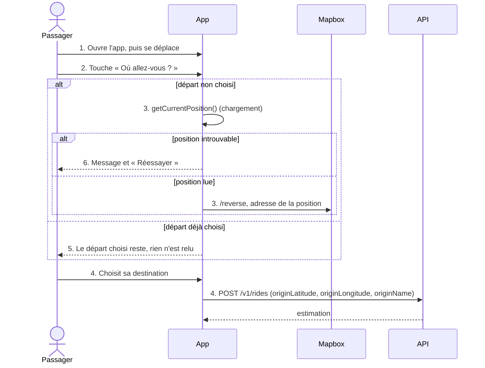

# Choisir son point de prise en charge

> Statut : livrée sur Android le 2026-11-05, testée par le user ; iOS préparé, non testé. Étape 6 (« Position actuelle » relue, 2026-11-15) codée, corrigée selon le user le 2026-11-15, non commitée.

Concerne `taxi-vroom-mobile` seulement : l'API n'a rien à changer (point 2 de « À valider », validé).

## Spec

### Besoin

Demandé par le user le 2026-11-05 : le passager doit pouvoir se faire prendre ailleurs que là où il se trouve, comme dans les applis de transport du marché. Aujourd'hui, la ligne de départ de la recherche affiche « Ma position », grisée et non modifiable (`destination_search_page.dart`) : la prise en charge est toujours la position du téléphone au moment de commander. C'est bloquant pour une réservation à l'avance : réserver de chez soi un taxi qui prendra demain à la gare est impossible.

### Comment ça marche

```text
Accueil passager : « Où allez-vous ? »
  ↓
Écran « Votre trajet », deux champs
  ├─ Départ : « Position actuelle » par défaut
  └─ Destination : le curseur y est, comme aujourd'hui
  ↓
Le passager touche Départ et tape une adresse
  App → Mapbox Search Box /suggest (déjà utilisé pour la destination)
  ↓ suggestions ; en tête, « Position actuelle » ; vide : les destinations récentes
  ↓
Ou « Choisir sur la carte » (Départ ou Destination, selon le champ actif)
  Carte plein écran, épingle fixe au centre ; le passager fait glisser la carte
  Carte immobile (onMapIdleListener) → App → Géoplateforme /geocodage/reverse
  ↓ l'adresse s'affiche sous l'épingle ; « Confirmer »
  ↓
Les deux champs remplis → choix du taxi, prix calculé depuis le départ choisi
  App → API : POST /v1/rides { originLatitude, originLongitude, destination… }
  API → Géoplateforme reverse : nomme le départ, comme aujourd'hui
  ↓
« Commander » ou « Réserver »
  ↓
Écran « Confirmer le point de prise en charge » (course immédiate et réservation)
  Carte centrée sur le départ, même épingle fixe, ajustable de quelques rues
  ↓ « Confirmer »
  Point déplacé : prix recalculé (POST /v1/rides), puis commande ou réservation
  Point inchangé : commande ou réservation directement
  ↓
Chauffeur : guidé vers ce point (rien ne change chez lui : il reçoit déjà le départ de la course)
```

#### 6. Le passager qui s'est déplacé depuis l'ouverture de l'app (décision du 2026-11-15)

1. Le passager ouvre l'app à un endroit, puis se déplace.
2. Il touche « Où allez-vous ? » (ou « Maison », « Travail ») : un chargement s'affiche sur l'accueil, sans rien à toucher, le temps que sa position soit lue.
3. « Votre trajet » s'ouvre alors, « Position actuelle » étant l'endroit où il se trouve à cet instant, jamais l'ancienne position.
4. Il choisit sa destination : le prix, l'itinéraire et le nom du départ partent de cette position.
5. S'il avait choisi un départ lui-même (suggestion, carte, « Maison », « Travail »), rien n'est relu : ce départ reste.
6. Si la position ne peut pas être lue, un message s'affiche avec « Réessayer ».



### Décisions prises

| Sujet | Décision |
|---|---|
| Plateformes | Android et iOS ; iOS préparé et non testé, faute de Mac |
| Le champ Départ | Un champ comme la destination, sur le même écran « Votre trajet », au-dessus. « Position actuelle » par défaut : le cas le plus fréquent ne coûte aucun geste |
| Recherche du départ | La même recherche que la destination (Mapbox Search Box, déjà en place, France, français), sans nouveau compte ni nouvelle clé |
| Chargement de la recherche (demandé par le user, 2026-11-06) | Les composants partagés `SearchTextField` et `SearchResults` (`lib/core/widgets`), comme la recherche de communes du chauffeur : la roue dans le champ cherché, à droite ; les suggestions d'avant grisées et impossibles à toucher jusqu'à la réponse. Remplace la roue au milieu, qui ne s'affichait que liste vide, et les suggestions d'avant laissées l'air à jour |
| Affichage du trajet (validé par le user, 2026-11-05, après un premier essai) | Comme les applis du marché : un seul bloc, un rond devant le départ et un carré devant la destination, reliés par un trait. « Position actuelle » est une vraie valeur, en couleur, pas une invite grise ; toucher le champ sélectionne le texte, taper le remplace. Une coche sur la ligne du départ retenu. Le premier essai (deux champs séparés, « Position actuelle » en gris) ne disait pas si la position actuelle était choisie |
| Suggestions du départ | « Position actuelle » toujours en tête, puis les résultats ; champ vide : les destinations récentes, déjà chargées à l'accueil |
| Choisir sur la carte | Le bouton « Choisir sur la carte », déjà présent mais vide, sert au champ actif, départ ou destination. Épingle fixe au centre, la carte glisse dessous : le geste habituel, plus précis qu'une épingle qu'on traîne du doigt |
| Adresse sous l'épingle | Demandée seulement quand la carte s'arrête (`onMapIdleListener` de `mapbox_maps_flutter` 2.31.1, installé), pas à chaque image du glissement |
| Le chauffeur | Rien ne change : il reçoit déjà le départ de la course, son nom et sa position, et y est guidé |
| Nom du départ gardé (validé par le user, 2026-11-05) | Seule la position part à l'API, qui nomme le départ avec la Géoplateforme, comme aujourd'hui : ses données sont sous licence ouverte, celles de Mapbox Search Box réservées à un usage temporaire. Un lieu comme « Gare de Strasbourg » est gardé sous son adresse |
| Adresse sous l'épingle (validé par le user, 2026-11-05) | La Géoplateforme reverse, appelée par l'app : la même source que le nom gardé |
| Tout sur Mapbox (validé par le user, 2026-11-11, remplace les deux lignes au-dessus) | La Géoplateforme a été en panne toute la journée du 2026-11-11 (504) : « Adresse inconnue » sous chaque épingle, départ gardé sans nom. Le user a demandé de tout passer sur Mapbox. Ce que voit le passager : sous l'épingle, l'adresse donnée par Mapbox ; le chauffeur et l'historique voient cette même adresse. *(App → Mapbox `/reverse` pour l'épingle et pour « Position actuelle » ; App → API `POST /v1/rides` avec `originName` ; l'API ne cherche plus d'adresse, la Géoplateforme n'est plus appelée nulle part.)* Sans adresse Mapbox, le départ garde le nom de secours « Position de départ ». Le risque de licence de Mapbox (« only available for temporary use ») est le même que pour la destination : `docs/a-faire.md`. Spec suivie : `heure-de-prise-en-charge.md`, étape 1 ter |
| Confirmer le point de prise en charge (validé par le user, 2026-11-05) | Un écran avant « Commander » et « Réserver », la carte centrée sur le départ, ajustable : l'usage du marché, un appui de plus par commande |
| Départ loin du téléphone (validé par le user, 2026-11-05) | Permis sans limite ni avertissement, pour une course immédiate comme pour une réservation ; si personne n'est là, l'absence existe déjà |
| « Position actuelle » relue à l'ouverture de « Votre trajet » (validé par le user, 2026-11-15) | Constat : la position était lue une seule fois à l'ouverture de l'app (`LoadPassengerHomeUseCase`, `PassengerHome.position`) et jamais relue : un passager qui s'était déplacé depuis commandait pour son ancienne position, alors que les taxis proches suivaient sa position réelle. Ce que voit le passager : 1. il touche « Où allez-vous ? » ; 2. « Votre trajet » s'ouvre, « Position actuelle » étant sa position du moment (un court chargement s'il faut attendre le GPS, jamais l'ancienne position affichée en attendant) ; 3. le choix du taxi, le prix et l'itinéraire partent de cette position. Un départ choisi (suggestion, carte, « Maison », « Travail ») reste fixe, il n'est jamais remplacé. Écarté : relire au tap sur « Commander » (le prix affiché serait celui d'un autre endroit que la commande). Raison : le comportement le plus simple pour le passager, le prix affiché étant celui de l'endroit où il commande ; aucune documentation officielle des applis du marché ne décrit un suivi automatique du départ, elles laissent surtout le corriger à la main *(App seulement : `getCurrentPosition()` à l'ouverture de « Votre trajet » quand `pickupPlace` est null ; l'API ne change pas)* |
| L'API | Elle prend déjà n'importe quel départ (`originLatitude`, `originLongitude`) et le nomme elle-même. Les chauffeurs cherchés sont ceux autour du départ, et la zone tarifaire est celle du départ : c'est déjà le cas |

### Règles

| Cas | Résultat |
|---|---|
| Le passager ne touche pas au départ | Départ = position du téléphone **au moment où il ouvre « Votre trajet »** (relue à chaque ouverture, validé par le user, 2026-11-15), et non plus celle de l'ouverture de l'app |
| Départ choisi dans les suggestions ou sur la carte | Le prix, les taxis cherchés et la zone tarifaire partent de ce point |
| « Position actuelle » choisie | Retour à la position du téléphone |
| Départ hors d'une zone servie | Le message actuel de l'estimation (`RIDE.AREA_NOT_SERVED`) |
| Adresse introuvable sous l'épingle (hors de France, erreur réseau) | « Adresse inconnue » sous l'épingle ; le point reste choisissable : l'API le nomme « Point de prise en charge » comme aujourd'hui |
| Point ajusté à l'écran de confirmation | Le prix est recalculé avant de commander : il dépend du départ |
| Retour arrière depuis la carte | Le champ garde sa valeur d'avant |
| Course commandée | Le départ ne change plus (le déplacer ensuite est noté dans `docs/a-faire.md`) |

### API

Aucune route nouvelle ni modifiée : `POST /v1/rides` reçoit déjà la position du départ, et l'API le nomme.

### Nouveaux éléments

**Mobile** :

- le départ dans le flux passager : `PassengerFlowBloc` le garde, comme l'heure de réservation ; la position du téléphone tant qu'il n'est pas choisi ;
- l'écran « Votre trajet » à deux champs : `DestinationSearchBloc` sait quel champ est actif ;
- une feuille plein écran « Choisir sur la carte », partagée par le départ, la destination et la confirmation, construite avec les composants `shadcn_flutter` et `lib/core/widgets` (règle `shadcnOnly`) ;
- dans `lib/features/passenger_home` : un dépôt qui donne l'adresse d'un point (Géoplateforme reverse), avec sa source de données ;
- la feuille « Confirmer le point de prise en charge » avant « Commander » et « Réserver » ;
- `TaxiChoicePage`, `RidePage` et l'estimation partent du départ choisi, et non plus de `homeState.home.position`.

Règles testées en TDD (Dart pur) : le départ par défaut (`PassengerHome.pickupAt`), le point sans adresse connue (`FindPlaceAtUseCase`), le prix recalculé seulement quand le point a bougé de plus de 10 m (`OfferFromPickupUseCase`).

### Tables touchées

Aucune : `rides` garde déjà le départ, son nom et sa position.

### Hors périmètre

- Les points de prise en charge imposés des gares et des aéroports (« Sortie 3, dépose-minute ») : il faudrait les saisir lieu par lieu.
- Commander pour quelqu'un d'autre (son nom, son téléphone, le code de montée envoyé à lui).
- Les lieux enregistrés (Domicile, Travail) : ils sont encore simulés, sans coordonnées.
- Déplacer le départ après la commande, et voir le passager en direct : notés dans `docs/a-faire.md`.
- Coller l'épingle à la route la plus proche.

## À valider

1. **L'écran « Confirmer le point de prise en charge ». Validé par le user, 2026-11-05 : oui.** Proposé : oui, avant « Commander » et « Réserver ». C'est l'usage du marché : le passager voit sur la carte où le taxi viendra exactement, et l'ajuste. Coût : un appui de plus par commande.
2. **Le nom du départ gardé en base. Validé par le user, 2026-11-05 : la Géoplateforme, l'API ne change pas.** Le user voulait d'abord garder l'adresse donnée par Mapbox : l'adresse est bien gardée dans tous les cas, seule sa source change. Garder les résultats de Mapbox demande un contrat (Search Box) ou une carte bancaire sur le compte avec `permanent=true` (Geocoding v6, qui ne donne pas les noms de lieux : « no longer provides POI data ») ; le compte n'en a pas. À revoir avec un contrat Mapbox quand l'app aura des clients. Hors de France, la Géoplateforme ne trouve rien : sans effet, un taxi français ne prend pas en charge à l'étranger et l'API refuse déjà un départ hors zone ; le nom de secours « Point de prise en charge » reste. La doc de Mapbox Search Box le dit : ses résultats sont « only available for temporary use » ; pour les garder, « contact Mapbox sales ». Or le nom du départ est gardé en base, vu par le chauffeur et l'historique. Proposé : n'envoyer que la position du départ, et laisser l'API le nommer avec la Géoplateforme, comme aujourd'hui (licence ouverte de l'État, déjà choisie pour cette raison dans `geoplateforme-address-finder.adapter.ts`). Conséquence : un départ choisi comme « Gare de Strasbourg » est nommé par son adresse, par exemple « 20 Place de la Gare 67000 Strasbourg ». L'API ne change pas. Écarté : envoyer le nom donné par Mapbox. Le même problème existe déjà pour le nom de la destination, gardé en base : à traiter à part.
3. **L'adresse sous l'épingle. Validé par le user, 2026-11-05 : la Géoplateforme.** Proposé : la Géoplateforme reverse, appelée par l'app : gratuite, sans clé, limitée à 50 requêtes par seconde par adresse IP, et la même source que le nom gardé par l'API, donc le passager voit le nom qui sera gardé. Écarté : Mapbox Search Box `/reverse`, facturé à chaque requête et réservé à un usage temporaire.
4. **Un départ loin du téléphone, pour une course immédiate. Validé par le user, 2026-11-05 : permis.** Proposé : permis sans limite ni avertissement pour la v1, comme une réservation ; le passager peut commander pour un point où il sera dans quelques minutes. Risque : le chauffeur arrive et personne n'est là ; l'absence existe déjà pour ce cas.

## Plan

Une étape à la fois, avec une pause et ta validation entre chaque.

### Étape 1 : le départ dans le flux (mobile)

- [x] Test d'abord (TDD) : `PassengerHome.pickupAt`, le départ choisi, sinon la position du téléphone ; 2 tests, rouges puis verts
- [x] `PassengerFlowBloc` garde le départ (`pickupPlace`, null pour « Position actuelle »), comme l'heure de réservation : gardé en revenant à l'accueil, remis à zéro après une commande ou une réservation ; nouvel événement `PassengerPickupPlaceChanged`. `TaxiChoicePage` (prix, route, « Arriver à ») et `RidePage` partent de `pickupAt` ; une course rouverte au démarrage ou par une notification part de la position du téléphone, comme avant
- [x] Vérifications : `dart format` sur les fichiers touchés, `flutter analyze` sans remarque, 101 tests verts, lint Bloc à ses 6 alertes habituelles
- Déplacé en codant, à valider par le user : la lecture de la doc de `mapbox_maps_flutter` et de la Géoplateforme passe à l'étape 3, où elles servent ; le test « prix recalculé seulement si le point a bougé » passe à l'étape 4, où cette règle sert ; « Position actuelle » n'est pas une règle à tester, juste un départ remis à null

### Étape 2 : le champ Départ et sa recherche (mobile)

- [x] Écran « Votre trajet » à deux champs, suggestions du départ avec « Position actuelle » en tête : `DestinationSearchBloc` sait quel champ est actif (`SearchField`, événement `DestinationSearchFieldFocused`) et rend le départ choisi (`selectedPickup`) ; même recherche Mapbox et mêmes destinations récentes pour les deux champs. Un départ choisi passe au flux (`PassengerPickupPlaceChanged`), et le curseur va à la destination ; un départ tapé mais pas choisi revient au départ gardé quand le champ perd le curseur
- [x] Vérifications : `dart format` sur les fichiers touchés, `flutter analyze` sans remarque, 101 tests verts, lint Bloc à ses 6 alertes habituelles ; pas de test nouveau, aucune règle métier dans cette étape
- [x] Reprise après le premier essai du user (2026-11-05) : bloc trajet rond, trait et carré ; « Position actuelle » écrit en bleu comme valeur, tout sélectionné au toucher, jamais envoyé à la recherche ; coche sur « Position actuelle » quand c'est le départ retenu. 107 tests verts, `flutter analyze` sans remarque

### Étape 3 : choisir sur la carte (mobile)

- [x] Doc officielle relue pour les versions installées : `mapbox_maps_flutter` 2.31.1, dans son code source (`onMapIdleListener` : « Invoked when the Map has entered the idle state », `getCameraState()` : « Returns the current camera state ») ; Géoplateforme : paramètres de `/geocodage/reverse` dans `https://data.geopf.fr/geocodage/getCapabilities` (le Swagger ne s'affiche pas sans navigateur), réponse vérifiée sur un appel réel (`name`, `postcode`, `city`, `label`)
- [x] Test d'abord (TDD) : `FindPlaceAtUseCase`, l'adresse sous l'épingle, ou « Point sur la carte » / « Adresse inconnue » sans adresse ou si le service échoue ; 3 tests, rouges puis verts
- [x] `AddressRepository`, sa source `AddressRemoteDataSourceImpl` (Dio sur `https://data.geopf.fr`, sans l'intercepteur Firebase) et `AddressModel` : dans `lib/features/passenger_home` et non `lib/core`, car ils rendent un `Place`, entité du passager (écart fait en codant). Le lieu garde le point choisi, pas celui de l'adresse trouvée
- [x] « Choisir sur la carte » : une feuille plein écran (`openPlacePickerSheet`, `openSheet` de shadcn_flutter, non glissable pour laisser bouger la carte) plutôt qu'un écran du flux (écart fait en codant : la même feuille sert à la confirmation, et rend le lieu comme la feuille « Ouvrir avec »). `PlacePickerBloc` cherche l'adresse quand la carte s'arrête, en abandonnant l'ancienne recherche ; le même centre n'est pas recherché deux fois. Pour le champ actif : départ, ou destination (qui ouvre le choix du taxi)
- [x] Vérifications : voir l'étape 4

### Étape 4 : confirmer le point de prise en charge (mobile)

- [x] Test d'abord (TDD) : `OfferFromPickupUseCase`, prix gardé si l'épingle est restée à 10 m près (l'arrondi de la carte), sinon recalculé depuis le nouveau point, et l'échec du nouveau calcul ne commande rien ; 3 tests, rouges puis verts
- [x] « Commander » et « Réserver » ouvrent d'abord la feuille « Confirmer le point de prise en charge », centrée sur le départ ; le lieu confirmé passe au flux ; `TaxiRideOrdered` et `TaxiRideBooked` portent le point confirmé, et `TaxiChoiceBloc` commande l'offre que rend `OfferFromPickupUseCase`. Point déplacé : les estimations suivantes partent de lui. Feuille fermée : rien n'est commandé
- [x] Vérifications : `dart format` sur les fichiers touchés, `dart fix` (ordre des imports) sur les 3 fichiers où des imports ont été ajoutés, `flutter analyze` sans erreur (restent des lignes trop longues déjà là et `one_member_abstracts`, comme les autres dépôts à une méthode), 107 tests verts, lint Bloc à ses 6 alertes habituelles

### Étape 5 : test (par le user)

- [x] Sans toucher au départ : tout marche comme avant
- [x] Départ tapé : le prix change, le chauffeur est guidé vers ce point, l'historique montre son adresse
- [x] Départ sur la carte : l'adresse suit l'épingle
- [x] Réservation pour demain avec un autre départ
- [x] Point ajusté à la confirmation : le prix est recalculé

Testé et validé par le user sur Android, 2026-11-05. iOS non testé, faute d'iPhone.

### Étape 6 : « Position actuelle » relue (mobile, décision du 2026-11-15, attend le go du user)

- [x] Doc officielle de `geolocator` 14.1.0 relue (`getCurrentPosition` : « Returns the current position », un relevé frais qui peut prendre plusieurs secondes, d'où le chargement ; lève `TimeoutException` et `LocationServiceDisabledException`, déjà traduites en `Failure` par `LocationRepositoryImpl`)
- [x] Test d'abord (TDD) : `RefreshPickupPositionUseCase`, 4 tests rouges puis verts : position relue sans lieu choisi, lieu choisi gardé sans interroger le téléphone, échec rendu tel quel, lieux enregistrés intacts
- [x] Codé, écarts faits en codant (techniques, dits au user) : la position est relue **avant** d'ouvrir l'écran suivant, avec un chargement par-dessus l'accueil et sans aucun appui possible, plutôt qu'après l'ouverture (la page « Votre trajet » reçoit son point de départ à sa création : l'ouvrir avant aurait montré l'ancienne position) ; le même chemin sert « Où allez-vous ? » et les raccourcis « Maison » / « Travail », qui ouvraient le choix du taxi avec la même ancienne position ; un échec laisse le passager sur l'accueil avec le message « Position introuvable » et « Réessayer » *(`PassengerHomeBloc` : événement `PassengerPositionRefreshed`, état `isLocating` et `locationFailure`)*
- Lecture de la position à l'ouverture de « Votre trajet » quand `pickupPlace` est null, avec un chargement, sans afficher l'ancienne position ; échec de position : message avec « Réessayer » (`loaderAlways`, `resultErrors`) ; la lecture et la règle (départ choisi gardé, sinon position relue) sont dans un use case du domaine, jamais dans le bloc (`logicInUseCases`) ; on réutilise `LocationRepository.getCurrentPosition()` et `PassengerHome`/`PassengerFlowBloc` existants, et on demande avant d'ajouter une nouvelle classe (`reuseFirst`) ; Android et iOS (`platforms`) : iOS préparé, non testé faute d'iPhone
- [x] Vérifications : `dart format` sur les fichiers touchés, `flutter analyze` sans remarque sur eux (les anciennes restent), 197 tests verts, lint Bloc non lu (il demande une mise à jour en interactif)
- [x] Test par le user, validé le 2026-11-15 (« problème corrigé », sans détail par cas ; position coupée et « Maison » non confirmés) : ouvrir l'app, changer la position de l'émulateur, toucher « Où allez-vous ? » : le départ est la nouvelle position ; idem avec « Maison » ; position coupée : message et « Réessayer »
- [ ] Ne pas toucher à `SharedPositionStream` ni à la présence du chauffeur

### Fin de feature

- [x] Mettre à jour `.aimemory` des deux dépôts
- [x] Commiter quand le user le demande (code commité le 2026-11-05 : mobile `73bdd5d`, API `0ec1bbf`)

## Sources

- [Mapbox, Search Box API](https://docs.mapbox.com/api/search/search-box/) : « only available for temporary use », « If your use case requires storing position data, contact Mapbox sales », et le `/reverse` « bills usage per request »
- [Géoplateforme, géocodage](https://cartes.gouv.fr/aide/fr/guides-utilisateur/utiliser-les-services-de-la-geoplateforme/geocodage/) : endpoint `https://data.geopf.fr/geocodage/reverse`, « Son usage est limité à 50 requêtes par seconde depuis une même adresse IP »
