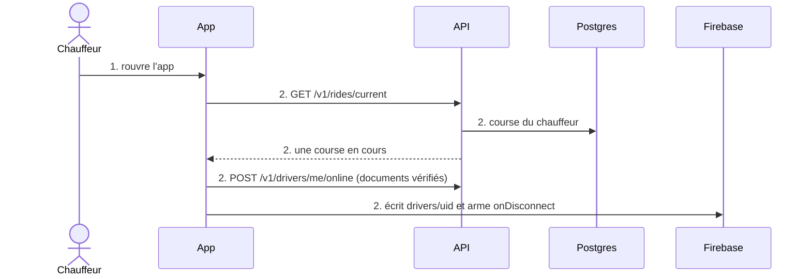
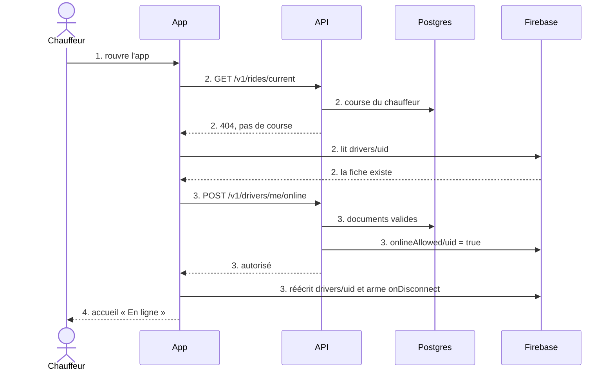
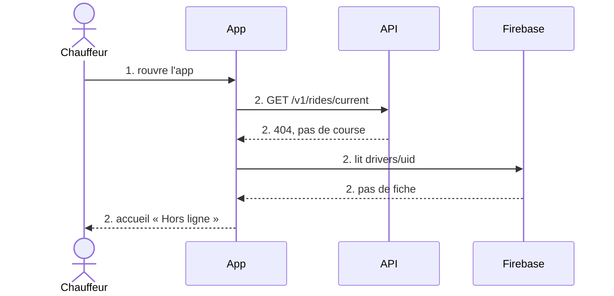
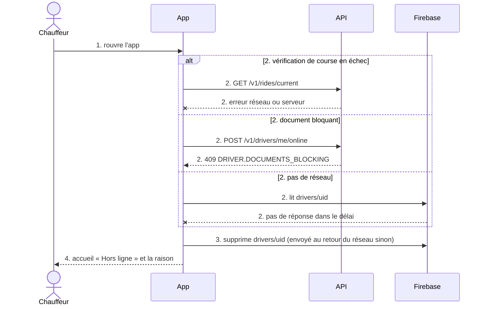
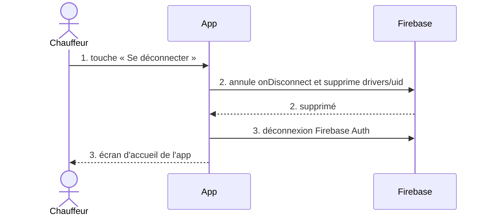

# Présence du chauffeur au démarrage et à la déconnexion

> Statut : codé le 2026-11-15 (les trois étapes d'un coup, à la demande du user), pas commité. Mobile : 11 tests nouveaux, 208 verts, `flutter analyze` sans nouvelle remarque, lint Bloc sans alerte sur `driver_home`. Attend le test du user (étape 4). iOS non testé.

Concerne `taxi-vroom-mobile` seulement : l'API n'a rien à changer. Cette spec vit dans l'API.

Les schémas sont des diagrammes de séquence Mermaid. GitHub les dessine dans les fichiers Markdown ([doc GitHub](https://docs.github.com/en/get-started/writing-on-github/working-with-advanced-formatting/creating-diagrams)). Syntaxe : [doc Mermaid, sequenceDiagram](https://mermaid.js.org/syntax/sequenceDiagram.html). Un point-virgule dans un message coupe la ligne : les schémas n'en ont pas.

## Spec

### Besoin

Constaté par le user le 2026-11-15 : après un redémarrage de l'app du chauffeur alors qu'il était en ligne, l'app affiche « Hors ligne », mais le passager voit un prix et « Commander le taxi » actif, comme si un taxi était libre. Vérifié le même jour dans Firebase : l'entrée `drivers/<uid>` du chauffeur était toujours là, `available: true`.

Ce qu'on appelle ici « la fiche » : l'entrée `drivers/<uid>` de Firebase, écrite par l'app quand le chauffeur passe en ligne (« je suis ici, je suis libre »), et supprimée quand il passe hors ligne ou que sa connexion tombe (`onDisconnect`). L'API ne sait pas elle-même qui est en ligne : elle lit cette fiche pour trouver les taxis libres.

Le problème : l'app redémarre en se croyant hors ligne et oublie sa fiche, qui reste. Même chose aujourd'hui pour « Se déconnecter » : la fiche n'est pas supprimée (`AuthBloc._onSignOutRequested` ne passe pas hors ligne). Le passager voit alors un taxi libre qui n'existe pas. C'est le cas `ghostDriverPresence` de la mémoire du mobile.

### Comment ça marche

Chaque situation se lit en deux temps : ce que voit l'utilisateur, étape par étape, puis le schéma de qui parle à qui. Les numéros du schéma renvoient aux étapes. Une étape absente du schéma se passe dans l'app seule.

#### 1. Le chauffeur rouvre l'app pendant une course

Rien ne change.

1. Le chauffeur rouvre l'app : un rond de chargement plein écran, comme aujourd'hui.
2. L'app voit qu'il a une course en cours, rouvre l'écran de cette course et le remet en ligne, comme aujourd'hui.

#### 2. Le chauffeur rouvre l'app sans course, sa fiche existe encore

1. Le chauffeur rouvre l'app : le rond de chargement plein écran reste affiché pendant toutes les vérifications.
2. L'app voit qu'il n'a pas de course, puis que sa fiche existe encore.
3. Il est remis en ligne par le même chemin que le bouton « Passer en ligne » : documents vérifiés, position prise, fiche réécrite.
4. L'accueil s'ouvre « En ligne », avec la notification « Vous êtes en ligne » du téléphone. Il n'a rien à toucher.
5. Comme quand il appuie sur « Passer en ligne », l'app vérifie la permission des notifications : si elle est refusée, le même message qu'aujourd'hui s'affiche.

#### 3. Le chauffeur rouvre l'app sans course, sans fiche

1. Le chauffeur rouvre l'app : le rond de chargement plein écran.
2. Pas de course, pas de fiche : l'accueil s'ouvre « Hors ligne », comme aujourd'hui. Il appuie sur « Passer en ligne » s'il veut.

#### 4. La remise en ligne est impossible

1. Le chauffeur rouvre l'app : le rond de chargement plein écran.
2. Quelque chose empêche de le remettre en ligne : un document bloquant, la position introuvable (GPS coupé, permission refusée), pas de réseau, ou l'app n'a pas pu savoir s'il avait une course.
3. Sa fiche est supprimée : aucun passager ne voit plus ce taxi.
4. L'accueil s'ouvre « Hors ligne », avec la raison, comme quand « Passer en ligne » échoue aujourd'hui : « Vos documents » s'ouvre pour un document bloquant, le message de position avec « Ouvrir les réglages » si besoin, le message de connexion sinon.
5. Il repasse en ligne lui-même quand c'est réglé.

#### 5. Le chauffeur se déconnecte en étant en ligne

1. Dans « Compte », il touche « Se déconnecter » alors qu'il est en ligne.
2. Le bouton montre le rond de chargement : l'app le passe d'abord hors ligne, sa fiche est supprimée.
3. Puis il est déconnecté et revient à l'écran d'accueil de l'app, comme aujourd'hui.
4. Le point 1 de « À valider » dit ce qui se passe sans réseau.

### Décisions prises

| Sujet | Décision |
|---|---|
| Plateformes | Android et iOS ; iOS préparé et non testé, faute d'iPhone |
| Source de vérité « en ligne » (décision technique, dite au user) | La fiche Firebase, pas l'API : l'API ne garde aucun état « en ligne » et n'apprend jamais qu'une app a été tuée, seul Firebase le sait (`onDisconnect`) |
| Fiche présente sans course (validé par le user, 2026-11-15) | Remise en ligne, quelle que soit la date de la fiche. Une condition « fiche récente » a été écartée : un chauffeur garé en ligne n'écrit rien sous 10 m, sa fiche peut avoir une heure et être juste |
| Risque accepté (validé par le user, 2026-11-15) | Une vraie fiche fantôme (plusieurs jours) remet en ligne un chauffeur qui ne l'avait pas demandé, à la réouverture : rare, il voit « En ligne » et « Passer hors ligne » tout de suite |
| Remise en ligne impossible (validé par le user, 2026-11-15) | Hors ligne, avec la raison, et la fiche supprimée : document bloquant, position introuvable, réseau, vérification de course en échec |
| Course inconnue (décision technique, dite au user) | Remise en ligne seulement si l'API a répondu « pas de course » (404). Sur une erreur, l'app ne sait pas si le chauffeur est en pleine course : le remettre « libre » serait faux |
| Même chemin que le bouton (décision technique) | La remise en ligne passe par `DriverOnlineToggled` / `SetOnlineUseCase`, comme « Passer en ligne » et la reprise de course (`_goBackOnlineDuringRide`) : documents vérifiés par l'API, envoi de la position en arrière-plan avec la notification « Vous êtes en ligne » (`SharedPositionStream`, correction du 2026-11-14 non touchée) |
| Déconnexion en ligne (validé par le user, 2026-11-15) | Passer hors ligne d'abord, puis se déconnecter : corrigé dans cette spec |
| Lecture de la fiche | Avec un délai maximum : sans réponse, c'est le cas « réseau » de la situation 4. Délai à fixer d'après la doc de `firebase_database` 12.6.0 (étape 1) |
| Où vit la règle (prefs mobile `logicInUseCases`) | Dans un use case du domaine (course répondue, fiche présente ou non, d'où « remettre en ligne » ou « rester hors ligne et supprimer la fiche »), testé en TDD (prefs `testsScope`). Pas dans un bloc |
| Qui déclenche (prefs mobile `noSiblingDeps`) | La page d'accueil du chauffeur, qui connaît déjà les deux blocs (`DriverFlowBloc` pour la course, `DriverHomeBloc` pour le en ligne), comme `_goBackOnlineDuringRide` aujourd'hui |
| Pas de nouveau porteur d'état hors Bloc (prefs `blocOnly`) | Les états de chargement et d'échec passent par les blocs existants |
| Choix faits en codant (techniques, dits au user) | `RestoreDriverPresenceUseCase` redemande la course à l'API (un `GET /v1/rides/current` de plus au démarrage sans course) : il ne dépend ainsi pas des états de `DriverFlowBloc`. Il ne se lance qu'au vrai démarrage, jamais quand la vérification des documents repasse par-dessus l'accueil après un « Passer en ligne » refusé. Délai de lecture de la fiche : 10 s ; connexion vérifiée en 3 s avant la déconnexion. À la déconnexion, l'envoi de position s'arrête d'abord (pour qu'une position tardive ne réécrive pas la fiche) et reprend si le chauffeur doit rester en ligne. La suppression confirmée (`goOfflineConfirmed`) attend la réponse du serveur, contrairement à « Passer hors ligne » |
| Navigation (prefs mobile `flowBuilderNav`) | « Vos documents » et l'accueil s'ouvrent par les états existants de `DriverFlowBloc` (`DriverDocumentsBlocked`, `DriverFlowHome`), jamais par `Navigator` |
| Écoute au bon endroit (hyp mobile `lateListener`) | Un `BlocListener` ignore l'état déjà là quand il apparaît : le déclencheur vit dans `DriverHomePage`, présent avant le premier état, comme l'écoute des offres corrigée le 2026-11-05 |

### Règles

| Cas au démarrage | Résultat |
|---|---|
| Course en cours | Reprise de la course et remise en ligne, comme aujourd'hui |
| Pas de course, fiche présente | Remis en ligne, accueil « En ligne » |
| Pas de course, pas de fiche | Accueil « Hors ligne », comme aujourd'hui |
| Vérification de course en échec | Hors ligne, fiche supprimée, message de connexion |
| Document bloquant | Hors ligne, fiche supprimée, « Vos documents » |
| Position introuvable | Hors ligne, fiche supprimée, message de position |
| Fiche illisible dans le délai | Hors ligne, fiche supprimée (envoyée au retour du réseau), message de connexion |

| Cas à la déconnexion | Résultat |
|---|---|
| Hors ligne | Déconnexion directe, comme aujourd'hui |
| En ligne | Hors ligne d'abord (fiche supprimée), puis déconnexion |
| En ligne, sans réseau | Voir le point 1 de « À valider » |

### API

Aucun changement. Routes déjà là : `GET /v1/rides/current`, `POST /v1/drivers/me/online`.

### Nouveaux éléments

- Mobile : lire la fiche `drivers/<uid>` (`DriverPresenceRemoteDataSource`, réutilisé), un use case pour la règle du démarrage, la déconnexion qui passe hors ligne d'abord. Noms fixés en codant, dits au user. Le use case est passé par `app.dart`, `AuthNavigator` et `DriverHomePage` (prefs mobile `noDiContainer`).
- Firebase : rien de nouveau. Le chauffeur lit sa propre fiche ; les règles publiées dans la console sont à vérifier pour cette lecture (elles ne sont pas dans le dépôt).

### Tables touchées

Aucune.

### Hors périmètre

- Le « signe de vie » régulier de l'app et l'API qui ignore les fiches trop vieilles : nécessaire pour un téléphone éteint ou sans réseau pour de bon, à faire à part.
- Le même compte sur deux téléphones : les deux écriraient la même fiche, rare, rien n'est fait.
- La correction du chauffeur qui quitte l'app pour Google Maps (`SharedPositionStream`) : ne pas toucher.

## À valider

1. **Se déconnecter en ligne, sans réseau. Validé par le user, 2026-11-15 : le message, et il reste connecté et en ligne.** La fiche ne peut pas être supprimée tout de suite. Proposé : le message « Connexion requise pour vous déconnecter en étant en ligne » et le chauffeur reste connecté et en ligne. Il réessaie quand le réseau revient. Raison : déconnecté, l'app n'a plus le droit d'écrire sa fiche, qui resterait alors pour de bon. Écarté : se déconnecter quand même, la fiche restant jusqu'à ce que Firebase coupe la connexion.

## Plan

Une étape à la fois, avec une pause et ta validation entre chaque.

### Étape 1 : la règle du démarrage (mobile)

- [x] Doc officielle relue : `firebase_database` 12.6.0 (`Query.get` : « Gets the most up-to-date result for this query ») et [Firebase, read and write, Flutter](https://firebase.google.com/docs/database/flutter/read-and-write) : sans le serveur, `get()` lit le cache local puis renvoie une erreur ; aucun délai donné, d'où les 10 s
- [x] Test d'abord (TDD) : `RestoreDriverPresenceUseCase`, 8 tests rouges puis verts (une ligne du tableau « Cas au démarrage » chacun, plus l'accueil sans position) ; `GoOfflineToSignOutUseCase`, 3 tests
- [x] `hasPresence` et `goOfflineConfirmed` dans `DriverPresenceRemoteDataSource`, rendus en `Result` par le repository (prefs mobile `resultErrors`)
- [x] Vérifications : `dart format` sur les fichiers touchés, `flutter analyze` sans nouvelle remarque, 208 tests verts

### Étape 2 : le démarrage dans l'app (mobile)

- [x] Le rond de chargement plein écran reste jusqu'à la décision (`DriverHomeReady.isRestoringPresence`, par-dessus les onglets qui gardent leur état) (prefs mobile `loaderAlways`)
- [x] Écart fait en codant : la remise en ligne passe par `SetOnlineUseCase` (le même que `DriverOnlineToggled`) appelé depuis `RestoreDriverPresenceUseCase`, puis `DriverHomeBloc` démarre l'envoi de position comme pour le bouton ; déclenchée par `DriverHomePage` (événement `DriverPresenceRestored`) ; sinon fiche supprimée et accueil « Hors ligne » avec la raison
- [x] Use cases passés par `app.dart`, `AuthNavigator`, `DriverHomePage`
- [x] Vérifications : `dart format`, `flutter analyze` sans nouvelle remarque, 208 tests verts, lint Bloc sans alerte

### Étape 3 : la déconnexion (mobile)

- [x] « Se déconnecter » en ligne : hors ligne d'abord (`DriverSignOutRequested`, `GoOfflineToSignOutUseCase`), avec le rond de chargement sur le bouton, puis déconnexion ; sans réseau, le message « Connexion requise pour vous déconnecter en étant en ligne. » et il reste connecté et en ligne (point 1). Hors ligne : déconnexion directe, comme avant
- [x] Vérifications : `dart format`, `flutter analyze`, tests verts

### Étape 4 : test (par le user)

- [ ] Hot restart en ligne sans course : « En ligne » au retour, le passager voit le taxi et peut commander, l'offre arrive
- [ ] Après cette remise en ligne : notification « Vous êtes en ligne », puis Google Maps une minute : la fiche reste, pas de « chauffeur déconnecté » chez le passager
- [ ] Hot restart hors ligne : « Hors ligne », le passager ne voit aucun taxi
- [ ] Hot restart en course : la course reprend, comme avant
- [ ] GPS coupé au redémarrage, puis réseau coupé : « Hors ligne » et la raison, aucun taxi chez le passager
- [ ] « Se déconnecter » en ligne : aucun taxi chez le passager ensuite

### Fin de feature

- [x] Mettre à jour `.aimemory` du mobile (done, hyp `ghostDriverPresence`, ltm driverApp : l'app ne démarre plus toujours hors ligne)
- [ ] Commiter quand le user le demande
