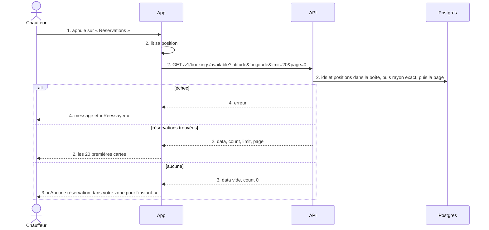
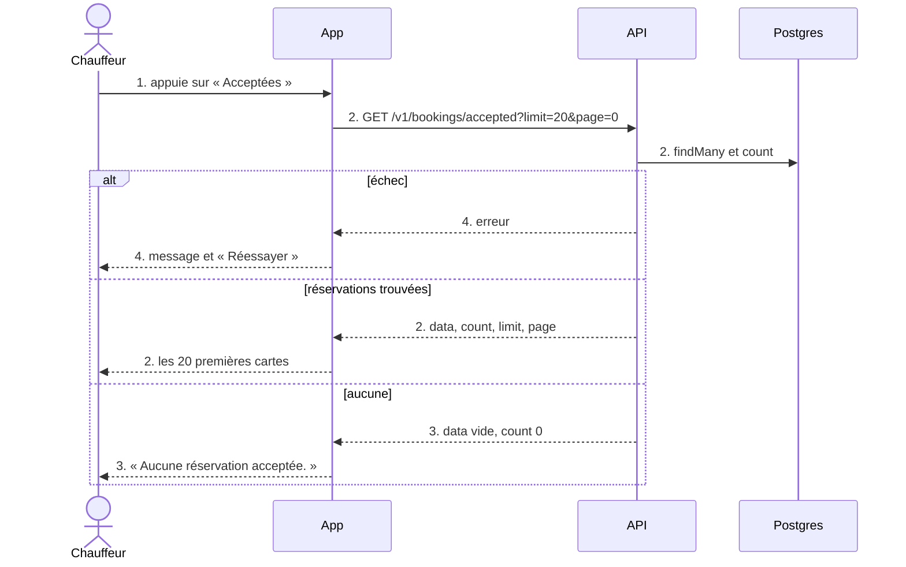
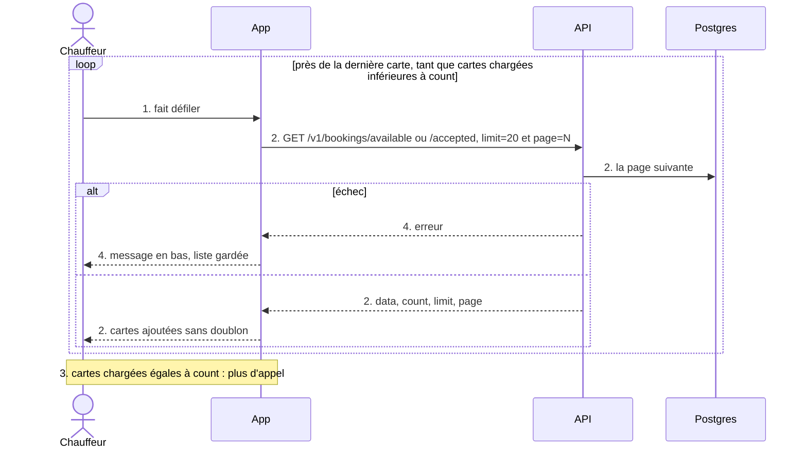
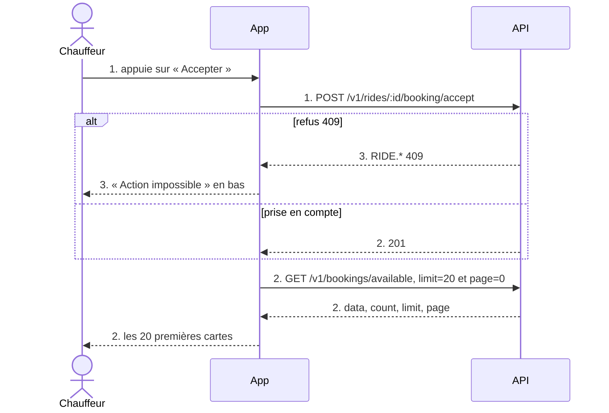
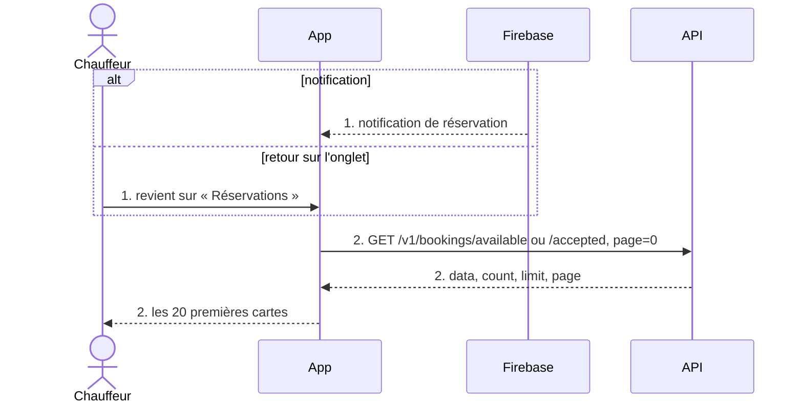

# « Réservations » du chauffeur par pages

> Statut : codée le 2026-11-14 (étapes 1 à 3 d'un coup, à la demande du user, exception à `stepPause`), pas commitée. API : `tsc` propre, lint à ses 9 erreurs habituelles, `deps:validate` à ses 5 anciennes violations. Mobile : aucune erreur d'analyse, 193 tests verts. Elle attend le test du user sur Android (étape 4) : rien n'est testé sur un appareil.

Concerne `taxi-vroom-api` et `taxi-vroom-mobile`. Cette spec vit dans l'API. Suite de `mes-courses-par-pages.md` (le passager), dont elle reprend les décisions : le user a demandé le 2026-11-14 la même chose pour l'onglet « Réservations » du chauffeur.

Les schémas sont des diagrammes de séquence Mermaid ([doc Mermaid, sequenceDiagram](https://mermaid.js.org/syntax/sequenceDiagram.html)). Un point-virgule dans un message coupe la ligne : les schémas n'en ont pas.

## Spec

### Besoin

Un chauffeur peut avoir énormément de réservations disponibles dans sa zone, et beaucoup d'acceptées. Aujourd'hui (code lu le 2026-11-14) :

- `GET /v1/bookings/available` et `GET /v1/bookings/accepted` renvoient tout, en un tableau, sans limite.
- Les deux listes se chargent ensemble à chaque arrivée sur l'onglet, à chaque réponse et à chaque notification, et le bouton affiche « Acceptées (27) ».
- `GET /v1/bookings/available` ne peut pas simplement prendre `skip` et `take` : la base ne filtre qu'une boîte autour du chauffeur. Le rayon exact de 20 km et la fin de validité des documents sont filtrés ensuite, en mémoire. Un `skip` et un `take` donneraient des pages incomplètes et un `count` faux.

### Comment ça marche

Chaque situation se lit en deux temps : ce que voit le chauffeur, étape par étape, puis le schéma de qui parle à qui. Les numéros du schéma renvoient aux étapes. Une étape absente du schéma se passe dans l'app seule.

#### 1. Le chauffeur ouvre « Réservations »

1. Il appuie sur « Réservations » : un rond de chargement remplace la liste, sous le titre et les deux boutons « Disponibles » et « Acceptées ».
2. Les 20 premières réservations de « Disponibles » arrivent, la plus proche dans le temps en premier, autour de sa position. Seule cette liste est chargée.
3. S'il n'y en a aucune, il lit « Aucune réservation dans votre zone pour l'instant. ».
4. Si le chargement échoue, il lit le message d'erreur et « Réessayer ».

#### 2. Le chauffeur appuie sur « Disponibles » ou « Acceptées »

1. Il appuie sur un des deux boutons, même sur celui déjà choisi : un rond de chargement remplace la liste, jamais l'ancienne liste pendant l'appel.
2. Les 20 premières réservations de cette liste arrivent. Pour « Disponibles », sa position est relue.
3. S'il n'y en a aucune, il lit « Aucune réservation dans votre zone pour l'instant. » ou « Aucune réservation acceptée. ».
4. Si le chargement échoue, il lit le message d'erreur et « Réessayer ».
5. Les boutons n'affichent aucun nombre : « Disponibles » et « Acceptées ».

#### 3. Le chauffeur descend dans la liste

1. Il fait défiler : près de la dernière carte, un petit rond apparaît sous elle.
2. Les 20 suivantes arrivent à la suite. Il ne perd pas sa place. Pour « Disponibles », la zone est celle de sa position au dernier chargement de la liste.
3. Quand toutes les réservations de la liste sont affichées, rien ne s'ajoute.
4. Si le chargement échoue, un message « Chargement impossible » apparaît en bas de l'écran, la liste reste telle quelle, et le prochain défilement essaie encore.

#### 4. Le chauffeur répond à une réservation

1. Il appuie sur « Accepter », « Refuser », « Se désister » ou « Je pars » : le bouton montre son rond, les autres boutons ne réagissent plus.
2. La réponse prise, la liste affichée se recharge depuis le début : un rond de chargement la remplace, puis ses 20 premières réservations arrivent. Le chauffeur revient en haut. Avec « Je pars », l'écran de prise en charge s'ouvre en même temps. L'autre liste se rechargera à son prochain appui.
3. Si le serveur refuse parce que la réservation a changé (prise, annulée), il lit « Action impossible » en bas de l'écran, puis la liste se recharge de la même façon.

#### 5. Une notification arrive, ou le chauffeur revient sur l'onglet

1. Une notification de réservation arrive (« Réservation annulée », « Réservation retirée »…), ou le chauffeur quitte l'onglet puis y revient.
2. Un rond de chargement remplace la liste affichée, puis ses 20 premières réservations arrivent.
3. Si le chauffeur est en train de répondre, le rechargement est ignoré : la réponse recharge déjà la liste à sa fin (règle de `mes-courses-a-jour.md`).

### Décisions prises

| Sujet | Décision |
|---|---|
| Comportement de la liste (validé par le user, 2026-11-14) | « UI exactement le même » que pour le passager : défilement sans fin par pages de 20, rond sous la dernière carte, rechargement depuis le début avec le rond de chargement |
| Un appui, un appel (validé par le user, 2026-11-14) | Chaque appui sur « Disponibles » ou sur « Acceptées » charge cette liste depuis la première page, même si elle était déjà chargée. À l'ouverture de l'onglet, seule « Disponibles » charge. Une réponse, une notification et un retour sur l'onglet rechargent la seule liste affichée. Remplace ma première proposition (les deux listes ensemble à chaque fois) |
| Une seule liste en mémoire | L'état ne garde que les pages de la liste affichée : l'autre est oubliée, puisque son prochain appui la recharge |
| Boutons sans nombre (validé par le user, 2026-11-14) | « Disponibles » et « Acceptées », sans « (27) » : le total d'« Acceptées » n'est plus connu avant son appui |
| Pagination | `page` et `limit`, la mécanique déjà en place, 20 par page, comme pour le passager (`mes-courses-par-pages.md`). Les deux routes renvoient `{ data, count, limit, page }` à la place du tableau, livrées ensemble avec l'app |
| Ordre stable | `pickupAt` croissant puis `id` croissant, pour les deux listes |
| `GET /v1/bookings/accepted` | Simple : `skip`, `take` et `count` sur la requête existante |
| `GET /v1/bookings/available` (choix technique) | Trois temps. (1) Une requête légère, avec les mêmes filtres que l'actuelle (boîte, places, refus, délai de 30 min, fin de validité des documents), qui ne lit que `id`, `originLatitude` et `originLongitude`, dans l'ordre. (2) Le rayon exact de 20 km sur ce résultat, en mémoire : le `count` est sa longueur, la page est une tranche. (3) Une requête `id in (...)` qui lit les champs complets de la page, dans le même ordre. Le rayon exact reste une règle de la requête de lecture, sans appel au domaine (`readNeverDomain`). Écartés : une formule de distance en SQL écrite à la main (elle doublerait les filtres de Prisma, et ils dériveraient), et la boîte seule (elle changerait la règle des 20 km, une décision produit) |
| Fin de validité des documents | Passe dans la clause `where` (`pickupAt` avant la fin) au lieu du filtre en mémoire, pour que `count` et pages la respectent |
| Position de « Disponibles » | Lue à chaque chargement de la liste depuis la première page, puis gardée pour ses pages suivantes : sinon un chauffeur qui roule verrait des pages d'une autre zone mélangées |
| Où vit la liste paginée | `PagedList` et `PagedListModel`, nés dans `passenger_home`, déménagent dans `lib/core` : deux fonctionnalités s'en servent, et l'une ne doit pas importer l'autre. Les imports du passager changent, rien d'autre |
| Alerte « Réservations … non proposées » | Reste en haut de « Disponibles », elle défile avec la liste |
| Tests | API : aucun (`noBackendTests`). Mobile : la règle de `PagedList` est déjà testée (8 tests) ; rien de nouveau en règle métier |

### Règles

| Cas | Résultat |
|---|---|
| Aucune réservation dans la zone | « Aucune réservation dans votre zone pour l'instant. » |
| Aucune réservation acceptée | « Aucune réservation acceptée. » |
| Position introuvable | L'échec actuel et « Réessayer », comme aujourd'hui |
| Page suivante en échec | Message en bas, liste gardée, nouvel essai au prochain défilement |
| Réponse en cours pendant une page | La page en cours est abandonnée, la réponse recharge la liste |
| Appui sur l'autre liste pendant une page | La page en cours est abandonnée |
| Réservation prise par un autre pendant le défilement | Elle peut rester affichée jusqu'au prochain rechargement : « Accepter » est alors refusé et la liste se recharge (règle existante) |
| Dernière page de 20 pile | `count` le dit : aucun appel de plus |

### API

| Route | Changement |
|---|---|
| `GET /v1/bookings/available?latitude&longitude&limit&page` | Paginée, réponse `{ data, count, limit, page }` (était un tableau). Tri : `pickupAt` croissant puis `id` |
| `GET /v1/bookings/accepted?limit&page` | Idem |

### Nouveaux éléments

**API** (chercher l'existant d'abord, `reuseFirst`) :

- `FindAcceptedBookingsQuery` et `FindAvailableBookingsQuery` passent à `PaginatedQueryBase` et renvoient `Paginated<DriverBooking>` (le modèle de `FindMyRidesQuery`), chacune avec son propre appel Prisma (`cqrsRead`) ;
- leurs contrôleurs reçoivent `PaginatedQueryRequestDto` (celui de la disponibilité garde `latitude` et `longitude`, en étendant le DTO existant), et renvoient un DTO paginé aux champs listés un à un, sur le modèle de `PassengerBookingPaginatedResponseDto` (`responseWhitelist`) ;
- `id` en second tri des deux requêtes ;
- aucune table, aucune migration.

**Mobile** :

- `PagedList` et `PagedListModel` déménagent dans `lib/core/domain/entities` et `lib/core/data/models` ;
- `DriverBookings` (deux tableaux) disparaît : l'état garde la liste affichée, ses pages, et la position de « Disponibles » ;
- les datasources et le dépôt prennent la page et renvoient `Result<PagedList<DriverBooking>>` ; `LoadDriverBookingsUseCase` (position puis première page de « Disponibles »), un cas d'usage pour la première page d'« Acceptées » et un par page suivante (`splitUseCases`), threadés par `app.dart`, `AuthNavigator` et `DriverHomePage` (`noDiContainer`) ;
- `DriverBookingsBloc` : le choix de la liste dans l'état, comme `RideHistoryBloc`, un événement par appui, un pour la page suivante, un état « page suivante en cours », page abandonnée si un rechargement ou une réponse a pris le dessus ;
- `driver_bookings_tab` : sans état local (le choix de la liste passe au bloc), `ListView.builder` (l'en-tête, les onglets, l'alerte et les cartes y sont des éléments), défilement qui demande la page suivante, rond sous la dernière carte, boutons sans nombre, composants `shadcn_flutter` ;
- chercher d'abord ce que `ride_history_tab` a déjà : le même défilement (`ScrollNotification` et `ScrollMetricsNotification`) sert aux deux écrans, à partager et non à recopier.

### Tables touchées

Aucune.

### Hors périmètre

- Un index sur `rides` pour la recherche de « Disponibles » (`kind`, `status` et position) : la table grossit des estimations abandonnées, mais le user n'a rien demandé ici. À noter dans `docs/a-faire.md` si le user le veut.
- Recherche ou filtre dans les réservations.

### Limites connues

- Réservation ajoutée ou prise pendant le défilement : une carte peut manquer ou rester jusqu'au prochain rechargement.
- « Disponibles » lit à chaque page les identifiants et positions de toute la zone, avant de découper : léger tant que les réservations ouvertes d'une zone se comptent en centaines.

## À valider

Rien : le comportement identique au passager, l'appel à chaque appui et les boutons sans nombre sont validés par le user le 2026-11-14. La spec attend son go pour l'étape 1.

## Plan

Une étape à la fois, avec une pause et ta validation entre chaque.

### Étape 1 : API

- [x] Doc officielle de Prisma : déjà relue et citée pour `mes-courses-par-pages.md` (page v6 : `skip` et `take` ; types générés du client 7.10.0 : `orderBy` en tableau). `id in (...)` et `lt` sur une date sont des filtres de base du client, confirmés par la compilation de `tsc` contre les types générés
- [x] `FindAcceptedBookingsQuery` paginée, `DriverBookingPaginatedResponseDto`, contrôleur
- [x] `FindAvailableBookingsQuery` en trois temps (ids et positions de la boîte, rayon exact, page lue par `id in`), la fin de validité des documents dans la clause `where`, contrôleur ; `FindAvailableBookingsRequestDto` étend `PaginatedQueryRequestDto` ; `soonestFirst` partagé par les deux requêtes
- [x] `npx tsc --noEmit` (propre), `npm run lint` (9 erreurs habituelles), `npm run deps:validate` (5 anciennes violations), lancés par moi

### Étape 2 : mobile, données

- [x] `PagedList` et `PagedListModel` déménagés dans `lib/core` (le test aussi, `test/core/domain/entities`), imports du passager mis à jour ; `PagedListModel.pageOf` découpe une page pour les deux fakes
- [x] Datasources (`getAcceptedBookings`, `getAvailableBookings` par page), dépôt en `Result<PagedList<DriverBooking>>`, trois cas d'usage (`LoadAvailableBookingsUseCase` : position puis première page, `LoadAvailableBookingsPageUseCase`, `LoadAcceptedBookingsUseCase`), entité `AvailableBookings` (position et première page), threadés par `app.dart`, `AuthNavigator` et `DriverHomePage`
- [x] `DriverBookings` et `LoadDriverBookingsUseCase` supprimés, fake mis à jour

### Étape 3 : mobile, bloc et écran

- [x] `DriverBookingsBloc` : liste affichée dans l'état (`shown`), un appui, un appel, page suivante, page abandonnée, rechargement à la réponse, à la notification et au retour sur l'onglet. Un état à usage unique `DriverBookingsAccepted` remplace la comparaison des deux listes qu'`_isBookingAccepted` faisait pour demander le rappel de réservation : une seule liste est en mémoire
- [x] `driver_bookings_tab` : en-tête fixe (titre, boutons sans nombre), `PagedListView` partagé avec l'écran passager (nouveau `lib/core/widgets/paged_list_view.dart`), l'alerte des documents est le premier élément de « Disponibles », message « Chargement impossible » en échec
- [x] `dart format` sur les fichiers touchés seulement, analyse sans erreur, 193 tests verts. `git status` : fichiers supprimés ou déplacés en plus de ceux du plan : `ride_history.dart`, `load_ride_history_usecase.dart` (étape précédente)

### Étape 4 : test (par le user)

- [ ] Plus de 20 réservations disponibles et acceptées en base : défilement jusqu'à la fin, rien en double
- [ ] Un appui sur « Disponibles » puis « Acceptées » : un rond et un appel à chaque appui
- [ ] « Accepter » au milieu de « Disponibles » : la liste se recharge depuis le début
- [ ] Échec réseau pendant une page : message, liste gardée, reprise au défilement

### Fin de feature

- [ ] Mettre à jour `.aimemory` des deux dépôts, `mes-courses-a-jour.md` et `mes-courses-par-pages.md` (le « hors périmètre » du chauffeur devient cette spec)
- [ ] Commiter quand le user le demande

## Sources

- Code lu le 2026-11-14 : `find-available-bookings.query-handler.ts`, `find-accepted-bookings.query-handler.ts`, `driver_bookings_bloc.dart`, `driver_bookings_tab.dart`, `driver_booking_repository_impl.dart`, `driver_booking_remote_datasource.dart`, `load_driver_bookings_usecase.dart`
- La doc de Prisma et de Flutter est citée dans `mes-courses-par-pages.md`
